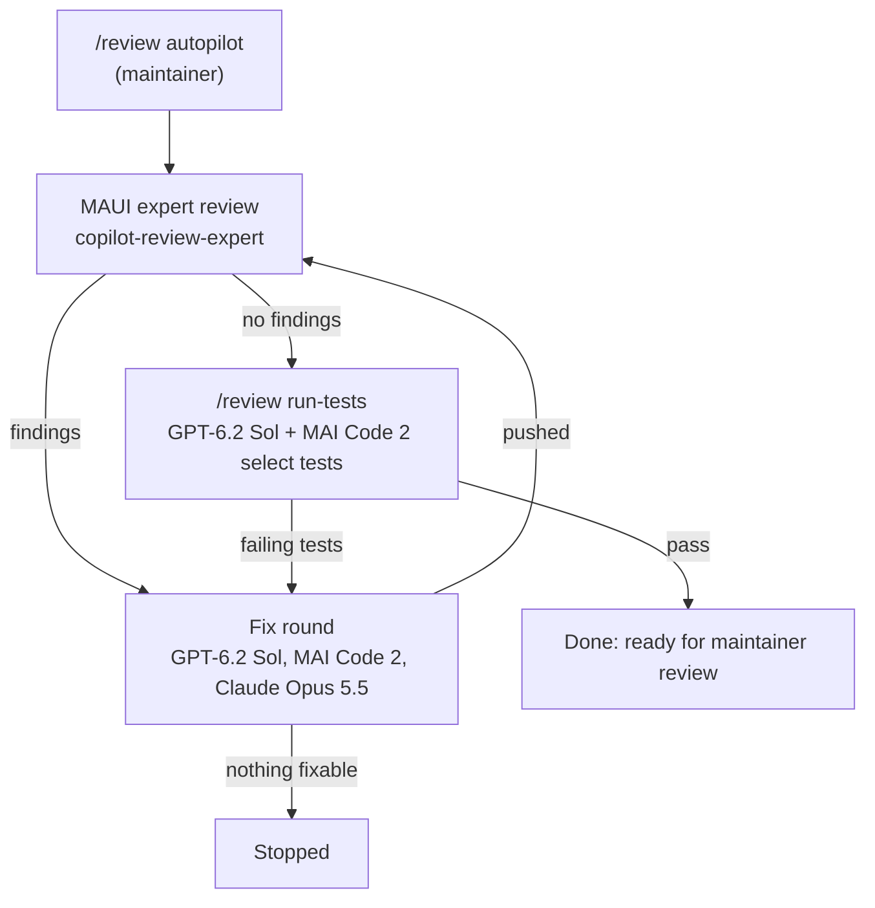

# maui-expert-autopilot

Its comments are titled **MAUI Autopilot**.

Contributors can let the MAUI agent finish their pull request instead of going through more rounds of review
themselves. The PR template has one checkbox:

> - [ ] **Let the MAUI agent address review feedback and fix remaining issues on this PR.**

When it's ticked, **one `/review autopilot` comment from a maintainer** drives the PR until the MAUI expert reviewer has
no findings and the relevant tests pass. Maintainers still decide whether the PR is merged.

The command comment is hidden as resolved once it's processed, like the other `/review` commands. `/review autopilot`
is excluded from the full `/review` trigger and from missed-command recovery.

## The loop

[`maui-expert-autopilot`](../workflows/maui-expert-autopilot.md) is the single state machine. Each time it's started, it looks at the PR
head and does the next step:

| State of the PR head | Next step |
|---|---|
| No `## Expert Review` | Request one from [`copilot-review-expert`](../workflows/copilot-review-expert.md), the same reviewer as `/review expert-review` |
| Expert review has findings | **Fix round** |
| Expert review is clean, no test run yet | Request [`/review run-tests`](../workflows/copilot-review-run-tests.md). GPT-6.2 Sol and MAI Code 2 each select the relevant UI and device tests, and the union runs in `maui-pr-uitests` / `maui-pr-devicetests` |
| Tests running | Wait |
| Tests failed | **Fix round** for the failures this PR causes |
| Tests passed (or nothing to run) | Done: comment, remove the label |
| Test run could not complete | Stop: comment, remove the label |

Each step starts `maui-expert-autopilot` again when it finishes, while the PR has `s/autopilot-running`:

- the expert reviewer's `autopilot_next` job,
- `review-run-tests-dispatch` after it queues the tests,
- `review-run-tests-results` when the run finishes,
- `maui-expert-autopilot`'s own `next_round` after a fix is pushed.

The loop has no round limit. It stops when:

- the tests pass,
- a fix round finds nothing it can fix,
- a maintainer removes the `s/autopilot-running` label,
- the author unticks the checkbox,
- the PR is closed,
- the maintainer who started the loop loses write access.

### Labels show where the PR is

While the loop runs, the PR has `s/autopilot-running` plus exactly one phase label. The phase label updates as
the loop moves:

| Label | Meaning |
|---|---|
| `s/autopilot-reviewing` | The MAUI expert review is running |
| `s/autopilot-fixing` | A fix round (GPT-6.2 Sol, MAI Code 2, Claude Opus 5.5) is running |
| `s/autopilot-testing` | `/review run-tests` is selecting or running the relevant tests |
| `s/autopilot-waiting-for-maintainer-review` | Done: the expert review is clean and the tests passed. Waiting for a maintainer |
| `s/autopilot-needs-maintainer-decision` | Stopped: nothing more the loop can fix, a step failed twice, or the tests couldn't run. A maintainer decides how to continue |
| `s/autopilot-retrying` | An expert review, fix round or test selection failed once and is being retried. A second failure in a row stops the loop |

Stopping the loop, for any reason, removes all `s/autopilot-*` labels, and a new `/review autopilot` replaces
`s/autopilot-waiting-for-maintainer-review`. Missing labels are created automatically.

### Fix rounds use three models

The main agent (GPT-6.2 Sol) writes down the items to fix. Then:

1. **Propose.** Each model fixes the items independently:
   - Claude Opus 5.5 goes first, in its own sandboxed workflow,
     [`maui-expert-autopilot-opus`](../workflows/maui-expert-autopilot-opus.md). The Copilot CLI uses one wire
     API per process: Claude is served over chat completions, while GPT-6.2 Sol and MAI Code 2 need the Responses
     API. Opus only writes a candidate patch, saved as an artifact, then continues the fix round. If it fails,
     the round continues with two candidates.
   - GPT-6.2 Sol, in the main agent, and MAI Code 2, through the in-workflow `autopilot-mai-fixer` agent, each in
     their own worktree.
2. **Cross-examine.** GPT-6.2 Sol and MAI Code 2 each review the other two candidates as an adversary (bugs,
   missed cases, weak tests, changes beyond the item), then revise their own candidate. They fix what the others
   found and adopt a better idea from another candidate, including Opus's, when there is one. There is one
   critique round. Opus's candidate is critiqued but not revised.
3. **Choose.** The main agent picks the best revised candidate per item. It considers correctness, whether
   every critique was answered, regression tests, size, the repo guidance, and validation results. It then runs
   the unit tests it can and commits one commit per item.

The thread reply names the model whose fix was kept, and any idea it adopted from another model.

The items come from:

- the expert review: all critical and major findings, plus small and safe moderate and minor ones,
- failing tests the PR causes. Before fixing anything, GPT-6.2 Sol, MAI Code 2 and Claude Opus 5.5 each judge every
  failure independently as `related`, `unrelated` (infrastructure, flaky, or already broken on the base branch) or
  `unsure`, using the failed jobs and error lines collected from Azure DevOps. The majority decides; a split counts as
  `related`. Only related failures are fixed, and the round's comment shows each model's verdict per failure,
- Copilot code review suggestions that are still open: after a clean expert review, open Copilot threads
  start a fix round before the tests run. Each one is fixed or answered in its thread,
- open maintainer requests.

How the fixes are published:

- **Same-repository PRs:** the round pushes to the PR branch.
- **Fork PRs:** gh-aw cannot push to contributor forks, so the round opens an `[autopilot]` follow-up PR. That PR
  keeps the contributor's commits, and the loop moves to it.

### The conversation happens in the review threads

The top level of the PR stays quiet. It gets two comments:

- a **start** comment, "MAUI Autopilot — Started", with collapsed **Models** and **Info** (what each label means) sections,
- a **finish** comment, "MAUI Autopilot — Ready for maintainer review", with collapsed **Results** (the clean
  expert review commit, the test result, review threads resolved) and, when needed, **Needs a decision** (threads
  left unchanged, by title). This comment is never hidden.

Only the latest status comment (started, stopped) stays visible: when a new one is posted, the earlier ones are hidden
as resolved, like `/review` command comments. The finish comment is not hidden. Commits, expert reviews, and test runs show up as normal timeline events. When maui-expert-autopilot runs the tests,
the run-tests comment leaves out its requester line.

In each review thread it handled, a fix round replies with one of:

- `✅ Fixed in <sha> <commit title>`: what changed, the test that proves it (fails before, passes after), and which
  model's fix was kept over the other model's, with the reason. The thread is then **resolved**, whoever started it.
- `❌ Not changed`: why. For example, the finding was wrong, an optional nit matching the file's style, would change
  the author's approach, or couldn't be reproduced. The thread stays open for a maintainer to decide.

If GitHub fails to resolve a thread, `next_round` and the finish step retry. Failing tests have no thread, so a fix
round for tests posts one short top-level comment. So does a round that published nothing, to explain why. The only
emojis in these comments are ✅ and ❌.

There are no footers, firewall notices, or "Commit pushed" comments. Commits are pushed unsigned with plain `git push`,
so the SHA in each reply matches the commit on the PR.

## Security

- Every step acts on behalf of the maintainer who commented `/review autopilot` (`requested_by`). maui-expert-autopilot, the expert
  reviewer (`Review-Expert.ps1`), and run-tests (`Invoke-RunTests.ps1`) each re-check that maintainer's write
  access. Only workflows in this repository can start a step as `github-actions[bot]`.
- The agent job has read-only GitHub permissions. Pushes, PRs, and comments go through gh-aw safe outputs, which
  target only the PR being driven. Threat detection checks the patch first. The agent only changes files under
  `src/`, and it never merges, approves, retargets, or closes PRs.
- The Copilot CLI loads `.github/` and `AGENTS.md` from the trusted base checkout, overlaid on the PR checkout and
  hidden from git. A PR cannot change the agent's instructions.
- Pushed commits use `GITHUB_TOKEN`, so they don't start the full CI by themselves. The loop runs the selected tests
  through `/review run-tests`.
