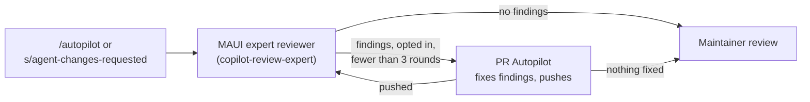

# PR Autopilot

Contributors can let the MAUI agent finish their pull request instead of going through more rounds of review
themselves. The PR template has one checkbox:

> - [ ] **Let the MAUI agent address review feedback and fix remaining issues on this PR.**

Nothing happens unless that box is ticked. Maintainers always decide whether a PR is merged.

## The review → fix loop

1. **Start.** A maintainer comments `/autopilot`, the AI review (`/review`) adds `s/agent-changes-requested`, or a
   maintainer runs the workflow manually.
2. **Review.** If the PR head has no MAUI expert review yet, [`pr-autopilot`](../workflows/pr-autopilot.md)
   dispatches [`copilot-review-expert`](../workflows/copilot-review-expert.md). That is the same expert reviewer as
   `/review expert-review`, with its dimension workers. It posts `## Expert Review — N findings` with inline comments.
3. **Fix.** When the PR is opted in, N > 0, and fewer than 3 autopilot rounds have run, the expert workflow's
   `autopilot_next` job dispatches PR Autopilot. The agent fixes the critical and major findings. It also fixes
   small, safe moderate and minor findings, maintainer feedback, the AI review findings, and failing checks.
   Wherever it fixes a bug, it adds a regression test. It runs the unit tests it can, then publishes:
   - **Same-repository PRs:** it pushes one commit per fix to the PR branch.
   - **Fork PRs:** gh-aw cannot push to contributor forks, so it opens an `[autopilot]` follow-up PR. That PR keeps
     the contributor's commits and adds the fixes. The loop continues on the follow-up PR.

   It posts one comment per round: what it fixed, what it didn't fix and why, and what it validated.
4. **Repeat.** After a push, `next_review` asks the expert reviewer for the next round. The loop stops when a review
   has no findings, when nothing could be fixed, or after 3 rounds. Then maintainers take over.

## Security

- The agent never merges, approves, retargets, or closes PRs. It only changes files under `src/`.
- The agent job has read-only GitHub permissions. Pushes, PRs, and comments go through gh-aw safe outputs, which
  target only the opted-in PR. Threat detection checks the patch first.
- It acts only on feedback from the expert reviewer, maintainers (owner, member, or collaborator), and the AI
  review. It treats the PR description, diff, and other comments as data.
- The Copilot CLI loads `.github/` and `AGENTS.md` from the trusted base checkout, overlaid on the PR checkout and
  hidden from git. A PR cannot change the agent's instructions.
- Every round acts on behalf of the maintainer who started the loop (`requested_by`). Each workflow re-checks that
  maintainer's current write access before a round runs, and the expert reviewer records them as the requester.
- Pushed commits use `GITHUB_TOKEN`, so they don't start CI by themselves. A maintainer starts CI as usual.
