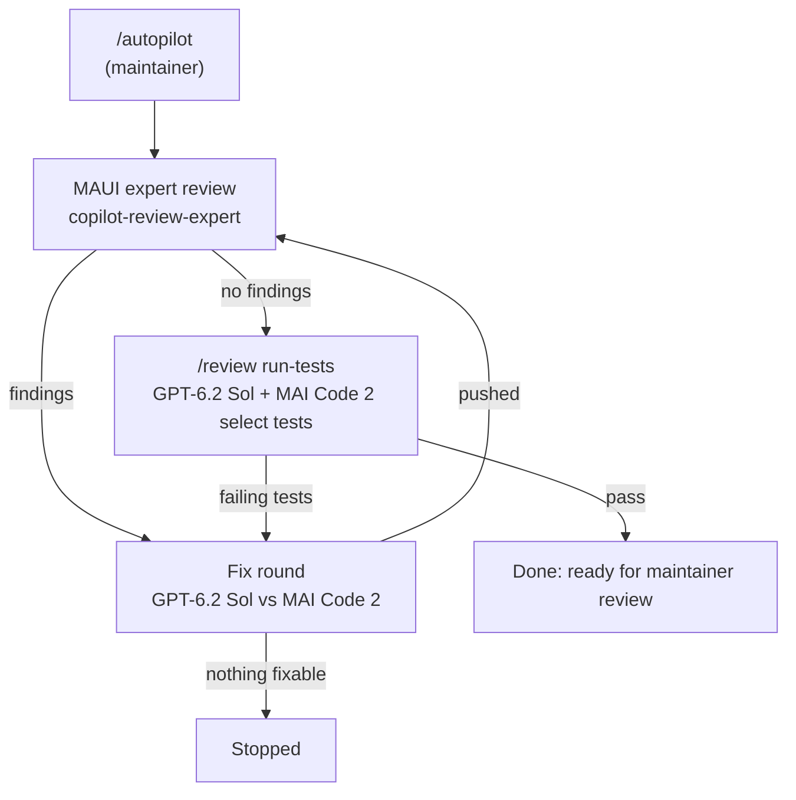

# PR Autopilot

Contributors can let the MAUI agent finish their pull request instead of going through more rounds of review
themselves. The PR template has one checkbox:

> - [ ] **Let the MAUI agent address review feedback and fix remaining issues on this PR.**

When it's ticked, **one `/autopilot` comment from a maintainer** drives the PR until the MAUI expert reviewer has
no findings and the relevant tests pass. Maintainers still decide whether the PR is merged.

## The loop

[`pr-autopilot`](../workflows/pr-autopilot.md) is the single state machine. Each time it's started, it looks at the PR
head and does the next step:

| State of the PR head | Next step |
|---|---|
| No `## Expert Review` | Request one from [`copilot-review-expert`](../workflows/copilot-review-expert.md), the same reviewer as `/review expert-review` |
| Expert review has findings | **Fix round** |
| Expert review is clean, no test run yet | Request [`/review run-tests`](../workflows/copilot-review-run-tests.md). GPT-6.2 Sol and MAI Code 2 each select the relevant UI and device tests, and the union runs in `maui-pr-uitests` / `maui-pr-devicetests` |
| Tests running | Wait |
| Tests failed | **Fix round** for the failures this PR causes |
| Tests passed (or nothing to run) | Done: comment, remove the label |
| Test run could not complete | Stop: comment, remove the label |

Each step starts `pr-autopilot` again when it finishes, while the PR has `s/autopilot-running`:

- the expert reviewer's `autopilot_next` job,
- `review-run-tests-dispatch` after it queues the tests,
- `review-run-tests-results` when the run finishes,
- `pr-autopilot`'s own `next_round` after a fix is pushed.

The loop has no round limit. It stops when:

- the tests pass,
- a fix round finds nothing it can fix,
- a maintainer comments `/autopilot stop` or removes `s/autopilot-running`,
- the author unticks the checkbox,
- the PR is closed,
- the maintainer who started the loop loses write access.

### Labels show where the PR is

While the loop runs, the PR has `s/autopilot-running` plus exactly one phase label. The phase label updates as
the loop moves:

| Label | Meaning |
|---|---|
| `s/autopilot-reviewing` | The MAUI expert review is running |
| `s/autopilot-fixing` | A fix round (GPT-6.2 Sol vs MAI Code 2) is running |
| `s/autopilot-testing` | `/review run-tests` is selecting or running the relevant tests |
| `s/autopilot-ready` | Done: the expert review is clean and the tests passed. Ready for maintainer review |

Stopping the loop, for any reason, removes all `s/autopilot-*` labels, and a new `/autopilot` replaces
`s/autopilot-ready`. Missing labels are created automatically.

### Fix rounds use two models

The main agent (GPT-6.2 Sol) writes down the items to fix. Each model then fixes them independently in its own
worktree:

- GPT-6.2 Sol, in the main agent,
- MAI Code 2, through the in-workflow `autopilot-mai-fixer` agent.

The main agent compares the two candidates item by item. It considers correctness, regression tests, size, the
repo guidance, and validation results, and keeps the better fix. It then runs the unit tests it can and commits one
commit per item.

The items come from:

- the expert review: all critical and major findings, plus small and safe moderate and minor ones,
- failing tests the PR causes: the round lists infrastructure and known-flaky failures instead of fixing them,
- open maintainer requests.

How the fixes are published:

- **Same-repository PRs:** the round pushes to the PR branch.
- **Fork PRs:** gh-aw cannot push to contributor forks, so the round opens an `[autopilot]` follow-up PR. That PR
  keeps the contributor's commits, and the loop moves to it.

### The conversation happens in the review threads

The top level of the PR stays quiet. It gets a **start** comment ("PR Autopilot started by @maintainer") and a
**finish** comment, for example: "ready for maintainer review · expert review clean · tests passed · 3 threads
resolved · 1 left open for maintainers". Commits, expert reviews, and test runs show up as normal timeline events.

In each review thread it handled, a fix round replies with one of:

- `✅ Fixed in <sha> <commit title>`: what changed, the test that proves it (fails before, passes after), and which
  model's fix was kept over the other model's, with the reason.
- `➖ Not changed`: why. For example, the finding was wrong, an optional nit matching the file's style, would change
  the author's approach, or couldn't be reproduced.

It then resolves the threads it fixed that the expert reviewer or the AI review started. Maintainers' threads stay
open with "I left this thread open so you can confirm and resolve it." Failing tests have no thread, so a fix round
for tests posts one short top-level comment. So does a round that published nothing, to explain why.

There are no footers, firewall notices, or "Commit pushed" comments. Commits are pushed unsigned with plain `git push`,
so the SHA in each reply matches the commit on the PR.

## Security

- Every step acts on behalf of the maintainer who commented `/autopilot` (`requested_by`). PR Autopilot, the expert
  reviewer (`Review-Expert.ps1`), and run-tests (`Invoke-RunTests.ps1`) each re-check that maintainer's write
  access. Only workflows in this repository can start a step as `github-actions[bot]`.
- The agent job has read-only GitHub permissions. Pushes, PRs, and comments go through gh-aw safe outputs, which
  target only the PR being driven. Threat detection checks the patch first. The agent only changes files under
  `src/`, and it never merges, approves, retargets, or closes PRs.
- The Copilot CLI loads `.github/` and `AGENTS.md` from the trusted base checkout, overlaid on the PR checkout and
  hidden from git. A PR cannot change the agent's instructions.
- Pushed commits use `GITHUB_TOKEN`, so they don't start the full CI by themselves. The loop runs the selected tests
  through `/review run-tests`.
