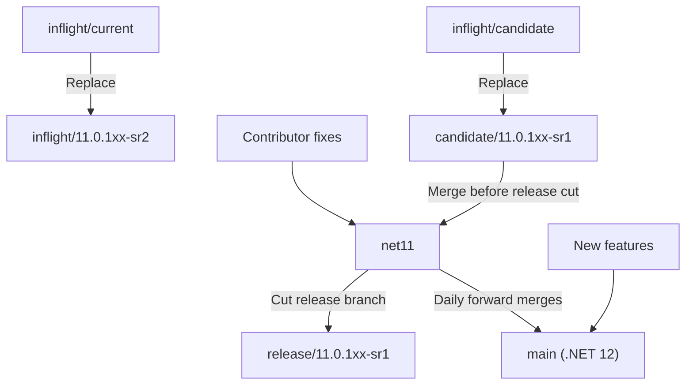
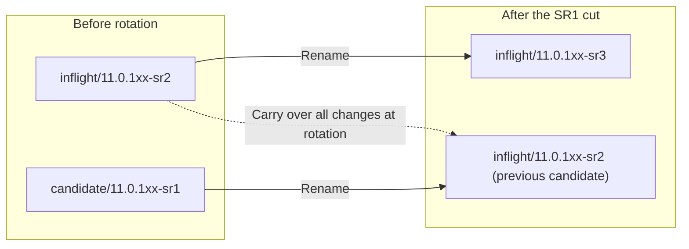

# Proposed versioned release branch workflow

This proposal separates .NET 11 fixes from .NET 12 feature development and replaces
the moving `inflight/current` and `inflight/candidate` names with release-specific
branches. It describes branch integration and release cuts; package building,
signing, and publishing remain covered by the [release process](ReleaseProcess.md).

> [!IMPORTANT]
> These are proposed branch names and responsibilities, not a statement that the
> migration has happened. The next-candidate naming decision below must be resolved
> before adopting the recurring rotation. This document does not rename branches
> or change release automation.

## Branch responsibilities

| Branch | Responsibility |
|---|---|
| `net11` | Contributor target for .NET 11 fixes. Receives the current candidate before a release is cut. |
| `main` | .NET 12 development, including new features and daily forward merges from `net11`. It remains named `main`. |
| `candidate/11.0.1xx-sr1` | Changes staged for the current servicing release, SR1, to be merged into `net11`. |
| `inflight/11.0.1xx-sr2` | Changes staged for the following servicing release, SR2, while SR1 is prepared. |
| `release/11.0.1xx-sr1` | Release branch cut from `net11` after the SR1 candidate is merged. This branch is not renamed as part of the next cycle. |

`net11` is the proposed branch name used throughout this workflow. Daily merges
flow from `net11` to `main`; the proposal does not call for merging .NET 12 feature
development back into `net11`.

## Initial migration and release cut

| Existing branch | Replacement |
|---|---|
| `inflight/current` | `inflight/11.0.1xx-sr2` |
| `inflight/candidate` | `candidate/11.0.1xx-sr1` |

Contributors target fixes at `net11`. Merge `candidate/11.0.1xx-sr1` into `net11`,
then cut `release/11.0.1xx-sr1` from the selected `net11` commit. The release is cut
from `net11`, not directly from the candidate or inflight branch. In parallel,
merge `net11` into `main` daily so .NET 12 development receives the fixes.

## Requested rotation after the SR1 cut

The requested branch moves are:

1. Rename the old `inflight/11.0.1xx-sr2` branch to `inflight/11.0.1xx-sr3`.
2. Rename the old `candidate/11.0.1xx-sr1` branch to `inflight/11.0.1xx-sr2`.
3. Bring all changes from the old SR2 inflight branch into the branch that was
   previously the SR1 candidate.

The source of the third step is the old SR2 inflight branch's contents at the
rotation, not the branch now reusing its name. Preserve that source commit when
planning the moves so the name reuse cannot select the wrong source.

### Next-candidate naming decision

The requested rotation above leaves two `inflight/...` branches and no
`candidate/11.0.1xx-sr2`. A candidate must be identified before the same
candidate-to-`net11` release flow can repeat.

The proposed clarification is to name the previous candidate branch
`candidate/11.0.1xx-sr2`, rather than `inflight/11.0.1xx-sr2`, after bringing over
the old SR2 inflight changes. The old SR2 inflight branch still advances to
`inflight/11.0.1xx-sr3`. This is a naming decision for the proposal, not an
approved change to the requested rotation.

With that clarification, the repeating cycle is:

| Release cut from `net11` | Next candidate | Next inflight |
|---|---|---|
| `release/11.0.1xx-sr1` | `candidate/11.0.1xx-sr2` | `inflight/11.0.1xx-sr3` |
| `release/11.0.1xx-sr2` | `candidate/11.0.1xx-sr3` | `inflight/11.0.1xx-sr4` |
| `release/11.0.1xx-sr3` | `candidate/11.0.1xx-sr4` | `inflight/11.0.1xx-sr5` |

For each SR number `N`, merge its candidate into `net11` and cut
`release/11.0.1xx-srN`. At rotation, the previous candidate receives all changes
from the old SR `N+1` inflight and becomes the SR `N+1` candidate, while the old
inflight advances to SR `N+2`. Keep the release branch separate from these moves,
and continue the daily `net11`-to-`main` merges.

## Adoption scope

Adopting this proposal requires coordinating the branch changes with their
protections, pipeline branch filters, scheduled merges, dependency-update
configuration, and internal release mirror. Those operational changes are outside
the scope of this documentation proposal. Existing contribution and release
instructions remain in effect until the migration is adopted.
