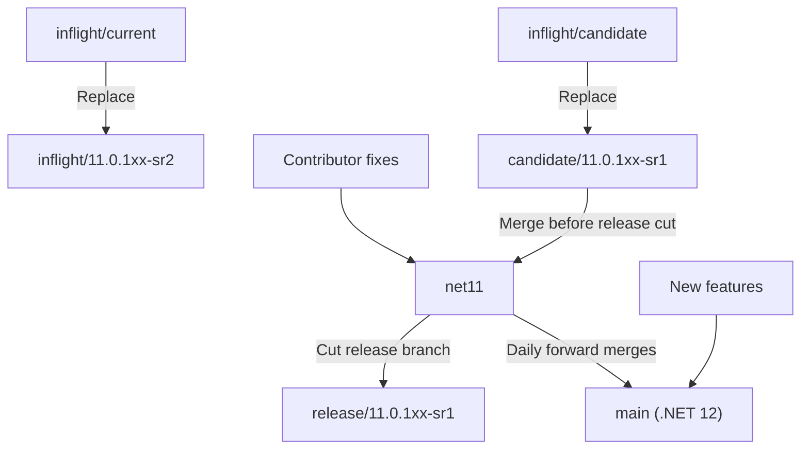
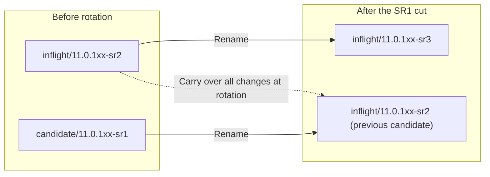
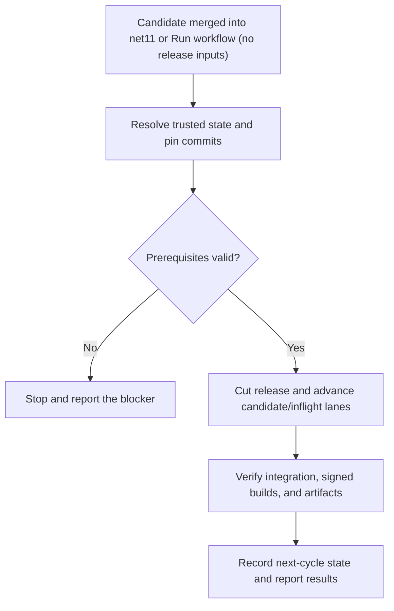
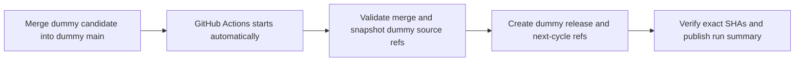

# Proposed versioned release branch workflow

This proposal separates .NET 11 fixes from .NET 12 feature development and replaces
the moving `inflight/current` and `inflight/candidate` names with release-specific
branches. It describes branch integration and release cuts; package building,
signing, and publishing remain covered by the [release process](ReleaseProcess.md).

> [!IMPORTANT]
> These are proposed branch names and responsibilities, not a statement that the
> migration has happened. The next-candidate naming decision below must be resolved
> before adopting the recurring rotation. This change does not rename production
> branches or enable production release automation.

## Branch responsibilities

| Branch | Responsibility |
|---|---|
| `net11` | Contributor target for .NET 11 fixes. Receives the current candidate before a release is cut. |
| `main` | .NET 12 development, including new features and daily forward merges from `net11`. It remains named `main`. |
| `candidate/11.0.1xx-sr1` | Changes staged for the current servicing release, SR1, to be merged into `net11`. |
| `inflight/11.0.1xx-sr2` | Changes staged for the following servicing release, SR2, while SR1 is prepared. |
| `release/11.0.1xx-sr1` | Release branch cut from `net11` after the SR1 candidate is merged. This branch is not renamed as part of the next cycle. |

`net11` is the proposed branch name used throughout this workflow. Daily merges
flow from `net11` to `main`; the proposal does not call for merging .NET 12 feature
development back into `net11`.

## Initial migration and release cut

| Existing branch | Replacement |
|---|---|
| `inflight/current` | `inflight/11.0.1xx-sr2` |
| `inflight/candidate` | `candidate/11.0.1xx-sr1` |

Contributors target fixes at `net11`. Merge `candidate/11.0.1xx-sr1` into `net11`,
then cut `release/11.0.1xx-sr1` from the selected `net11` commit. The release is cut
from `net11`, not directly from the candidate or inflight branch. In parallel,
merge `net11` into `main` daily so .NET 12 development receives the fixes.



## Requested rotation after the SR1 cut

The requested branch moves are:

1. Rename the old `inflight/11.0.1xx-sr2` branch to `inflight/11.0.1xx-sr3`.
2. Rename the old `candidate/11.0.1xx-sr1` branch to `inflight/11.0.1xx-sr2`.
3. Bring all changes from the old SR2 inflight branch into the branch that was
   previously the SR1 candidate.

The source of the third step is the old SR2 inflight branch's contents at the
rotation, not the branch now reusing its name. Preserve that source commit when
planning the moves so the name reuse cannot select the wrong source.



### Next-candidate naming decision

The requested rotation above leaves two `inflight/...` branches and no
`candidate/11.0.1xx-sr2`. A candidate must be identified before the same
candidate-to-`net11` release flow can repeat.

The proposed clarification is to name the previous candidate branch
`candidate/11.0.1xx-sr2`, rather than `inflight/11.0.1xx-sr2`, after bringing over
the old SR2 inflight changes. The old SR2 inflight branch still advances to
`inflight/11.0.1xx-sr3`. This is a naming decision for the proposal, not an
approved change to the requested rotation.

With that clarification, the repeating cycle is:

| Release cut from `net11` | Next candidate | Next inflight |
|---|---|---|
| `release/11.0.1xx-sr1` | `candidate/11.0.1xx-sr2` | `inflight/11.0.1xx-sr3` |
| `release/11.0.1xx-sr2` | `candidate/11.0.1xx-sr3` | `inflight/11.0.1xx-sr4` |
| `release/11.0.1xx-sr3` | `candidate/11.0.1xx-sr4` | `inflight/11.0.1xx-sr5` |

For each SR number `N`, merge its candidate into `net11` and cut
`release/11.0.1xx-srN`. At rotation, the previous candidate receives all changes
from the old SR `N+1` inflight and becomes the SR `N+1` candidate, while the old
inflight advances to SR `N+2`. Keep the release branch separate from these moves,
and continue the daily `net11`-to-`main` merges.

## Rolling integration PRs

Maintain these two draft PRs against the fixes branch, `net11`:

| Title | Head | Purpose |
|---|---|---|
| `[Release candidate] 11.0.1xx SR1` | `candidate/11.0.1xx-sr1` | The current release's reviewed integration into `net11`. |
| `[Next release preview] 11.0.1xx SR2` | `inflight/11.0.1xx-sr2` | Visibility into the following release, like the historical `inflight/current` tracking PR. Do not merge this ahead of the current candidate. |

`Release tracking PRs` reconciles these routes from the canonical release-state
record every six hours, when that record changes on `main`, after a same-repo
candidate PR merges into `net11`, or on zero-input manual activation. It checks out
trusted `main`, not the merged PR's head, and requires only repository read access
and scoped PR write access.

Production PRs must be authored as `kubaflo`, with a short role description and
a Mermaid graph highlighting the tracked lane. Local reconciliation uses the
existing authenticated `gh` login. Unattended GitHub-hosted reconciliation is
opt-in through `RELEASE_TRACKING_ENABLED=true` and requires an approved
`RELEASE_TRACKING_TOKEN` authenticating as `kubaflo`; the default Actions bot is
not an author fallback. This change does not install a user token or enable
that production workflow automatically.

The reconciler creates missing PRs as drafts, refreshes managed titles and
descriptions, and never approves or merges them. A head-branch change requires a
new PR: GitHub cannot retarget an existing PR's head. After both new-cycle PRs
exist, it closes obsolete PRs bearing its own scope marker. It does not adopt or
close unrelated human-created PRs, including the legacy tracking PR, automatically.
If an exact route already has an unmanaged PR or multiple open PRs, reconciliation
stops for inspection rather than creating a duplicate.

GitHub will not create a PR whose head has no commits ahead of its base. In that
case the reconciler explicitly reports `waiting-for-changes` and creates the PR
when real changes arrive; it does not add fake commits to satisfy a literal
"always two" count. Initially, the SR1 candidate was seeded at the same commit as
`net11`, so that route must wait for changes. Existing PRs can remain open while
their diff becomes empty.

The release rollover must advance `currentSr` in the protected state record and
invoke reconciliation after the new lane refs are ready. Updating the record also
advances the titles and routes to candidate SR2 and inflight SR3. Branch pushes
then update each PR's diff naturally.

For read-only inspection before deployment:

```powershell
pwsh -NoProfile -File eng/scripts/Sync-ReleaseTrackingPullRequests.ps1 -PlanOnly
```

## Nightly builds and dogfood feeds

Versioned inflight branches must keep the same nightly contract as
`inflight/current`: the internal `dotnet-maui` pipeline, daily 05:00 UTC signed
builds, `ci.inflight` package branding, workload artifacts, BAR registration, and
the configured dogfood feed. Renaming or creating a public branch alone does not
provide any of those external integrations.

The official schedule recognizes versioned `inflight/*xx-sr*` refs. A selection
stage runs before packing on scheduled inflight builds and reads the release
state from a pinned commit on public `main`. It selects only one publishing lane:

| `nightlyMode` | Eligible nightly source |
|---|---|
| `legacy` | `inflight/current` |
| `versioned` | `inflight/<releaseBand>-sr<currentSr+1>` |

The checked-in mode remains **`legacy` during migration**. In versioned mode,
SR1's inflight source is SR2; after the trusted release state advances to SR2,
the source becomes SR3 automatically. Retained older inflight branches and the
legacy branch skip packing when not selected, so they cannot make a retired
stream appear fresh. Missing or invalid canonical state fails selection instead
of falling back to another branch.

Versioned inflight refs keep `PreReleaseVersionLabel=ci.inflight` and the existing
signing path. `main`, candidate branches, tags, and other inflight experiments
retain their existing branding. No feed or channel is invented from the SR name;
the existing publishing and Maestro configuration must be preserved and verified.
The readiness feed check continues measuring `ci.inflight`, not a fresh
`ci.main` build.

Before switching `nightlyMode` to `versioned`, deploy the schedule/selection,
signing, and branding changes to the mirrored legacy and active versioned
branches. Verify that the internal mirror has the exact selected public commit,
that its default-channel/feed wiring matches the existing nightly contract, and
that a signed internal build publishes the expected artifacts. Do not rewrite
mirror history or promote workload-release packages as part of this migration.
The same deployment prerequisite applies when each new lane is created.

The public PR and sandbox do not deploy internal mirrors, change Maestro
subscriptions, or certify an actual signed nightly. They must not be reported as
an operational nightly cutover until that internal evidence exists.

The internal YAML preview accepted both the ordinary path and the
scheduled-inflight template path, including the selection-stage dependency on
`Pack`. The latter preview supplied explicit scheduled branch context through a
root YAML override because preview requests do not adopt the queued system
variables. It did not queue a build or execute signing or publishing.

## One-click release automation

The proposed activation point is a GitHub Action after a reviewed candidate
merge into `net11`, with a zero-input **Run workflow** option for manual
activation. Internal signed-build work would remain in Azure DevOps. Production
orchestration is not implemented or enabled by this change. A separate GitHub
Actions sandbox below exercises automatic activation after a dummy candidate
merge without enabling production release operations.

### Operator experience

Merging the reviewed candidate into `net11` would start the release preparation
automatically, without an additional button. For manual activation, the release
owner would open GitHub Actions and select **Run workflow**. Neither path has
release fields to fill in: the owner does not select or type the release band, SR
number, branch names, commit SHAs, build IDs, or channel names. Activation is the
authorization to perform the configured routine branch rollover; there is no
second routine approval prompt for those operations.

The pipeline generates and records its resolved plan, checks prerequisites, runs
the rollover, and reports the resulting refs and validation links. If a
prerequisite is missing or the release state is ambiguous, it stops with an
actionable explanation rather than guessing values or asking the operator to
complete a release form.

Normal candidate-PR reviews and any required external configuration or
package-publication approvals remain separate. Activation must not bypass branch
protections or existing service approval checks.

### Automatic input resolution

Each activation target is bound to one release train through a trusted,
version-controlled release-state record. Initial setup defines the train and
branch roles once, including the resolved candidate-naming policy. Multiple
active trains must not be resolved by guessing from the highest branch number or
from `main`, which represents a different .NET version in this proposal.

| Input | Resolved automatically from |
|---|---|
| Release band and development branches | The configured release train and its `net11` / `main` branch roles. |
| Current SR and candidate/inflight refs | The active lane state, validated against actual refs and the configured naming policy. |
| Release source commit | The eligible, approved candidate merge into `net11`, with required validation at the exact selected commit. |
| Next candidate and inflight names | The current SR number and the agreed SR `N+1` / SR `N+2` rotation rules. |
| Build and BAR identities | Eligible signed-build evidence for the pinned release commit and configured official pipeline; never an unrelated latest build. |
| Channel mappings, subscriptions, and mirror refs | Their trusted configuration, checked against the selected release train; never invented from branch-name similarity. |

Candidate integration and its normal reviews must be complete before a release
cut can proceed. The pipeline detects that state itself; the operator does not
enter a merge SHA. When a signed build is needed, it queues or locates the build
for the pinned commit and waits for eligible results instead of requesting a
build ID from the operator.



### Execution safeguards

Serialize runs per release train and persist a checkpoint for each completed
operation. Recheck expected source SHAs before mutations, and resume the same
recorded cycle after an interruption rather than starting a different plan.
Advancing lane names alone must not make another release eligible: a new cycle
requires a distinct approved candidate merge that has not already been released.
Repeated activation without one reports the existing cycle or the missing
prerequisite, rather than cutting the next SR accidentally.

Only report success when the required integrations and validation have completed.
Configuration PRs that still need owner approval are pending work, not successful
handoffs. The routine rollover must not force-push history, delete historical
release refs, or publish packages. Package publishing retains the separate gates
in the [release process](ReleaseProcess.md).

The daily `net11`-to-`main` merge PR runs on a schedule independently of release
activation, stopping for conflicts or failed validation instead of guessing fixes.

### Read-only planning trial

A branch-planning prototype is available without release inputs:

```powershell
pwsh -NoProfile -File eng/scripts/Get-ReleaseRolloverPlan.ps1
```

It reads the proposed state in `eng/release-rollover.json`, queries branch refs
without changing them, and emits a JSON snapshot with the derived release, next
candidate, and next inflight names. The checked-in candidate-naming policy is
deliberately `unresolved`; the trial must report that decision and any missing
branches rather than silently choose a different workflow.

Exit code `0` means only that branch planning completed. Exit code `2` means
the plan is blocked by missing source refs, occupied destination names, or the
unresolved naming policy; malformed state or Git failures also fail explicitly.
Every result has `canExecute: false` and lists the release requirements that this
prototype does not verify. A complete branch plan is not release readiness.

For isolated development trials, `-StatePath` can point at a separate state file
whose repository is a disposable local Git repository. This is not a release form
or an activation input for the proposed pipeline. The Azure pipeline, branch
mutations, external integrations, and publishing are not implemented by this
prototype.

### GitHub Actions merge-triggered sandbox

The **Release rollover sandbox** workflow runs automatically when a merge is
pushed to `release-rollover-trial/<trial>/main`. That branch is an isolated dummy
integration target, not the real `main` branch. In the proposed production
workflow, the candidate still merges into `net11`, while real `main` receives
daily fixes for .NET 12.

The workflow derives the release band and SR number from the candidate ref
matching the merge commit's second parent. It requires a two-parent merge, an
unchanged integration HEAD, and an inflight branch containing that candidate.
An ordinary commit, ambiguous candidate, missing source, divergent history, or
destination at a different SHA stops the run instead of guessing. A shallow fetch
that cannot prove ancestry also stops the run.

For a dummy SR1 candidate merge, it creates only these sandbox refs:

| Dummy output under `release-rollover-trial/<trial>/` | Source commit |
|---|---|
| `release/11.0.1xx-sr1` | The exact candidate merge commit on dummy `main`. |
| `candidate/11.0.1xx-sr2` | The pinned old SR2 inflight commit, which must contain SR1's candidate changes. |
| `inflight/11.0.1xx-sr3` | The same pinned old SR2 inflight commit. |

This trial uses the proposed `candidate/...` naming clarification only inside
the sandbox. It creates new refs and preserves historical source branches; it
does not test renaming or deletion. The real naming policy remains unresolved.



Each sandbox has a serialized workflow concurrency group. Existing outputs at
the exact expected SHAs are left unchanged, so a rerun resumes missing creations
or reports no changes. Creation is sequential, not a cross-ref transaction; a
failed run can leave partial outputs recorded in its artifact. Existing targets
are never updated, and moved source refs require inspection before resuming.

After creating its next-cycle refs, the sandbox invokes the same tracking-PR
reconciler with a sandbox-scoped state file. Both dummy PRs target dummy `main`,
never a real development branch. This exercises PR creation and repeated
reconciliation without enabling the production release workflow.

The workflow uses its scoped `GITHUB_TOKEN`, with no new personal token or
repository secret. It does not use `pull_request_target`, check out fork code, or
run an AI agent. There is no trigger on real `main`, `net11`, `candidate/...`, or
`inflight/...`. Normal merge commits are required for this trial; squash and
rebase merges are not supported. The workflow can also be activated manually on
a sandbox integration ref after it is available for dispatch in GitHub.

This exercises branch operations only. It does not validate production
permissions, candidate approvals, signed builds, packages, dependency
subscriptions, channel mappings, the internal mirror, or production rollback.

### Live sandbox evidence

The GitHub-hosted trial used `release-rollover-trial/sr1-2ad2e0af/` on
2026-11-05. Both cycles were activated by actual candidate merges pushed to the
dummy integration branch, not by a fabricated event payload or a local script.

| Scenario | Observed result |
|---|---|
| [SR1 candidate merge](https://github.com/dotnet/maui/actions/runs/42035924272) | Created dummy release SR1 at the merge SHA, candidate SR2, and inflight SR3 automatically. |
| Same activation rerun, attempt 2 | Reported `unchanged`, created no refs, and left every dummy ref at the same SHA. |
| [SR2 candidate merge](https://github.com/dotnet/maui/actions/runs/42036225919) | Detected SR2 without version inputs and created dummy release SR2, candidate SR3, and inflight SR4. |
| [Ordinary non-merge push](https://github.com/dotnet/maui/actions/runs/42036351766) | Failed as intended with the two-parent-merge diagnostic and created no release or next-cycle refs. |

Distinct marker files confirmed that release SR1 contained the SR1 candidate
change but not the future SR2 change; candidate SR2 contained both, and release
SR2 subsequently included the future change. Run artifacts recorded exact source
and output SHAs. The real development and release-lane refs were unchanged by
the trial.

## Adoption scope

Adopting this proposal requires coordinating the branch changes with their
protections, pipeline branch filters, scheduled merges, dependency-update
configuration, and internal release mirror. Those operational changes are outside
the scope of this documentation proposal. Existing contribution and release
instructions remain in effect until the migration is adopted.
