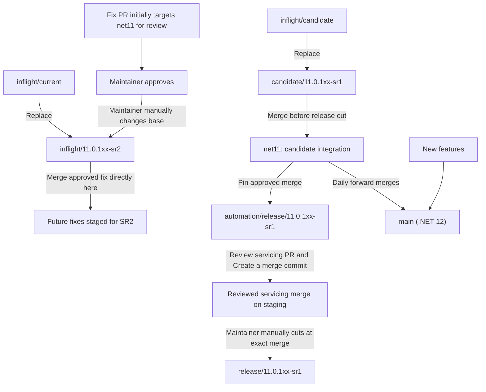
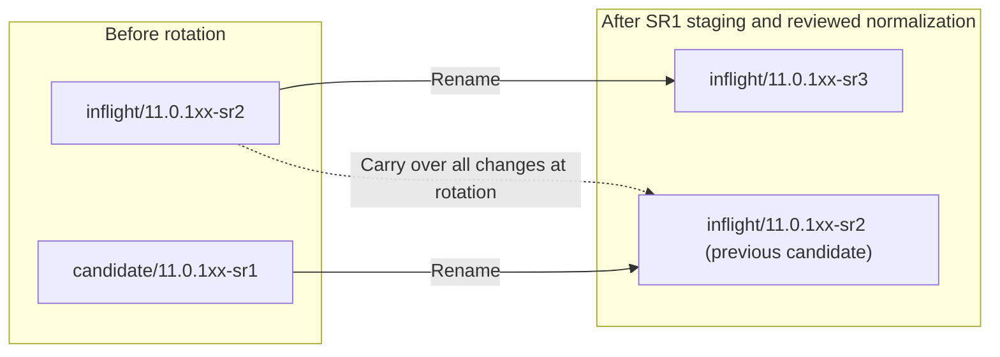
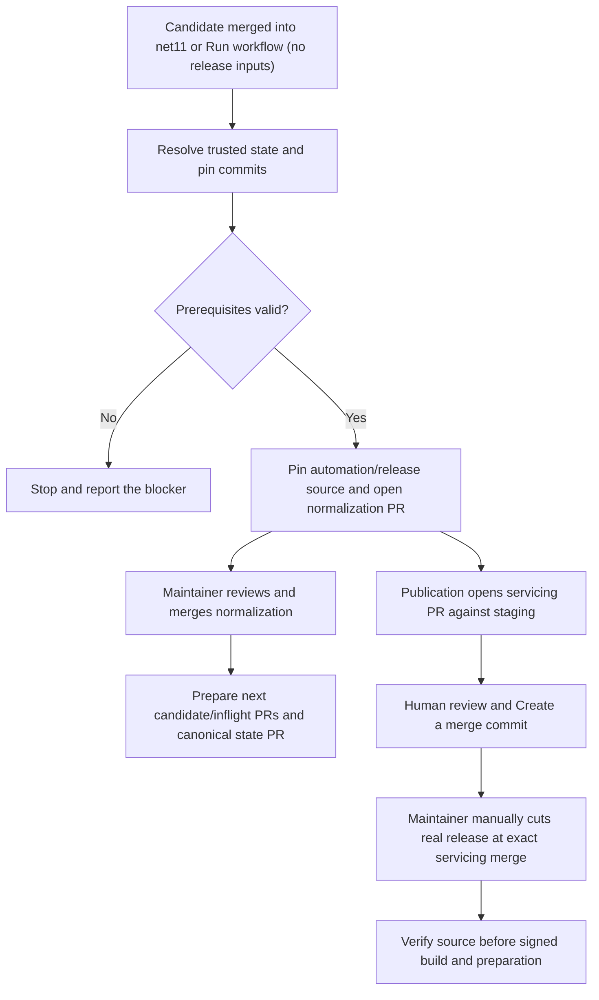
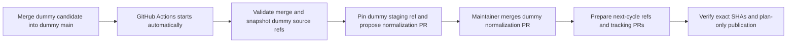

# Proposed versioned release branch workflow

This proposal separates .NET 11 fixes from .NET 12 feature development and replaces
the moving `inflight/current` and `inflight/candidate` names with release-specific
branches. It describes branch integration and release cuts; package building,
signing, and publishing remain covered by the [release process](ReleaseProcess.md).

> [!IMPORTANT]
> These are proposed branch names and responsibilities, not a statement that the
> migration has happened. Candidate merges automatically prepare the next named
> branches and tracking PRs once this automation is deployed on `main`. Actual
> staging refs are automatic; real release cuts are manual and happen only when
> the maintainer wants to release. Next-cycle CI housekeeping is prepared as a
> reviewed PR so the protected `net11` branch is never written directly. The
> publication workflow automatically opens a servicing/stable PR against staging.
> Review it and merge using **Create a merge commit**, then manually create the
> real release branch at that exact reviewed servicing merge commit.
> Tags, public publication, and signed nightly deployment retain their own gates.

## Branch responsibilities

| Branch | Responsibility |
|---|---|
| `net11` | Initial review target for .NET 11 fix PRs, not their final landing branch. Receives the current candidate before a release is cut. |
| `main` | .NET 12 development, including new features and daily forward merges from `net11`. It remains named `main`. |
| `candidate/11.0.1xx-sr1` | Changes staged for the current servicing release, SR1, to be merged into `net11`. |
| `inflight/11.0.1xx-sr2` | Changes staged for the following servicing release, SR2, while SR1 is prepared. |
| `automation/release/11.0.1xx-sr1` | Created at the approved SR1 candidate merge into `net11`, then advanced only by the separately reviewed servicing/stable PR using Create a merge commit. Independent of next-cycle progress. |
| `release/11.0.1xx-sr1` | Manually cut by the maintainer at that exact reviewed servicing merge, even after the train advances. Never created, moved or deleted by rollover. |

`net11` is the proposed branch name used throughout this workflow. Daily merges
flow from `net11` to `main`; the proposal does not call for merging .NET 12 feature
development back into `net11`.

The public `net11` branch preserves all `main` history through
`f3b45e183ce6d9bdb28b3e090d849ddfdbc37eb0`, before the .NET 12 transition.
The branch name remains literal `net11`, distinct from historical `net11.0`.
The primary build, device-test and UI-test YAML include `net11` and
`candidate/*` in push/PR filters. The official build includes `net11` for its
schedule, signing, localization and API scanning. Deploy these definitions and
review server-side protections before relying on the new branch's CI.
The reviewer/gate and immutable snapshot validation recognize these names too,
but provisioning with credentials requires the new servicing/staging targets to
be protected. Until protection is configured, review setup fails explicitly
instead of switching a credential-bearing worktree to an unprotected branch.

## Initial migration and release cut

| Existing branch | Replacement |
|---|---|
| `inflight/current` | `inflight/11.0.1xx-sr2` |
| `inflight/candidate` | `candidate/11.0.1xx-sr1` |

Contributors open fix PRs against `net11` for review. After approval, a maintainer
manually changes the PR's base to the active inflight branch, currently
`inflight/11.0.1xx-sr2`, and merges the fix directly there. Individual fixes do
not merge directly into `net11`; bots never change the base or merge them. Required CI
must validate the final inflight base after the change.

Separately, merge `candidate/11.0.1xx-sr1` into `net11`. Automation pins
`automation/release/11.0.1xx-sr1` to that exact approved merge and opens reviewed
normalization. After normalization merges, it prepares the next pair and state
PR without requiring a real release branch. Independently, publication opens a
servicing/stable configuration PR against `automation/release/11.0.1xx-sr1`.
Review it and merge using **Create a merge commit**, then manually create
`release/11.0.1xx-sr1` at that exact servicing merge, not the original candidate
merge, later normalized `net11` tip, or a candidate/inflight head. In parallel,
merge `net11` into `main` daily so .NET 12 development receives the fixes.



## Requested rotation after SR1 staging

The original requested rotation was expressed as branch moves:

1. Rename the old `inflight/11.0.1xx-sr2` branch to `inflight/11.0.1xx-sr3`.
2. Rename the old `candidate/11.0.1xx-sr1` branch to `inflight/11.0.1xx-sr2`.
3. Bring all changes from the old SR2 inflight branch into the branch that was
   previously the SR1 candidate.

The source of the third step is the old SR2 inflight branch's contents at the
rotation, not the branch now reusing its name. Preserve that source commit when
planning the moves so the name reuse cannot select the wrong source.



### Recurring candidate naming

The requested rotation above leaves two `inflight/...` branches and no
`candidate/11.0.1xx-sr2`. A candidate must be identified before the same
candidate-to-`net11` release flow can repeat.

The selected convention is to name the next selected-content branch
`candidate/11.0.1xx-sr2`, rather than `inflight/11.0.1xx-sr2`, after bringing over
the old SR2 inflight changes. The old SR2 inflight branch still advances to
`inflight/11.0.1xx-sr3`. The trusted configuration records
`candidateNamingPolicy: candidate`; automation creates the next pair without
renaming, deleting, or overwriting the historical source refs.

With that clarification, the repeating cycle is:

| Approved merge staged from `net11` | Next candidate | Next inflight |
|---|---|---|
| `automation/release/11.0.1xx-sr1` | `candidate/11.0.1xx-sr2` | `inflight/11.0.1xx-sr3` |
| `automation/release/11.0.1xx-sr2` | `candidate/11.0.1xx-sr3` | `inflight/11.0.1xx-sr4` |
| `automation/release/11.0.1xx-sr3` | `candidate/11.0.1xx-sr4` | `inflight/11.0.1xx-sr5` |

For each SR number `N`, merge its candidate into `net11` and pin
`automation/release/11.0.1xx-srN`. After reviewed normalization, the next candidate receives all changes
from the old SR `N+1` inflight and becomes the SR `N+1` candidate, while the old
inflight advances to SR `N+2`. The real release cut is manual and independent of these moves.
Continue the daily `net11`-to-`main` merges.

## Rolling integration PRs

Maintain these two draft PRs against the fixes branch, `net11`:

| Title | Head | Purpose |
|---|---|---|
| `[Release candidate] 11.0.1xx SR1` | `candidate/11.0.1xx-sr1` | The current release's reviewed integration into `net11`. |
| `[Next release preview] 11.0.1xx SR2` | `inflight/11.0.1xx-sr2` | Visibility into the following release, like the historical `inflight/current` tracking PR. Do not merge this ahead of the current candidate. |

These are release integration trackers, not individual fix PRs. Keep their base
at `net11`. The manual review-to-inflight retargeting rule applies to each
approved individual fix; it does not mean merging the future preview into
`net11` early.

`Release tracking PRs` reconciles these routes from the canonical release-state
record every six hours, on pushes to `main`, after a same-repo candidate or
inflight PR merges into `net11`, or on zero-input manual activation. The merged-PR
trigger runs from the default branch and checks out trusted `main`, never the
merged PR's workflow or scripts. Its credential needs PR write access and branch
creation access for recovery; repository protections still apply.

GitHub-hosted reconciliation uses its repository-scoped `GITHUB_TOKEN`:
new automated PRs are authored by `github-actions[bot]`. No personal token,
repository secret, or user impersonation is needed. Each description has a short
role explanation and a Mermaid graph highlighting its lane. Existing managed
PRs can retain their original human author while the bot updates them; their
authors cannot be changed in place. Newly recreated PRs use the bot.
Sandbox titles explicitly identify the trial so they cannot be confused with
real release trackers. Manual CLI reconciliation uses the caller's existing
authenticated identity.

The reconciler creates missing PRs as drafts, refreshes managed titles and
descriptions, and never approves or merges them. A head-branch change requires a
new PR: GitHub cannot retarget an existing PR's head. After both new-cycle PRs
exist, it closes obsolete PRs bearing its own scope marker. It does not adopt or
close unrelated human-created PRs, including the legacy tracking PR, automatically.
If an exact route already has an unmanaged PR or multiple open PRs, reconciliation
stops for inspection rather than creating a duplicate.

GitHub will not create a PR whose head has no commits ahead of its base. In that
case the reconciler explicitly reports `waiting-for-changes` and creates the PR
when real changes arrive; it does not add fake commits to satisfy a literal
"always two" count. Initially, the SR1 candidate was seeded at the same commit as
`net11`, so that route must wait for changes. Existing PRs can remain open while
their diff becomes empty.

Merge handling is automatic as well. If a tracking PR merges but the same lane
is still current, its replacement waits until that head has new commits ahead of
`net11`; the next lane push triggers reconciliation. Once the trusted release
state advances, reconciliation creates the next candidate and preview PRs with
updated SR numbers, branches, descriptions, and highlighted graphs, then retires
obsolete managed previews. It does not increment the release state just because
someone merged a preview PR.

After an explicitly authorized integration-branch reset, merged candidate PRs
outside its pinned live history do not advance the cycle or count as duplicate
integrations. A squash merge still in that history remains rejected; a reset
does not relax the exact two-parent merge requirement. If several eligible
maintainer candidate merges remain in history, the latest merge is authoritative,
not the first receipt or an older managed PR occupying the same cycle.

GitHub can automatically delete a head branch after merge. If a current lane ref
is missing, the reconciler restores it only from a live, verified, same-repo
merged managed PR's exact head SHA. It never resets an existing branch, invents
the development target, restores an obsolete role from an older release state,
or recreates a branch from an unrelated/unmerged PR.

After exact staging, reviewed normalization and next-lane preparation are
verified, the rollover prepares a draft **Release state** PR into the configured
feature/default branch. It changes only `currentSr` in
`eng/release-rollover.json`; the canonical file is not written directly.
Merging the reviewed update makes candidate SR2 and inflight SR3 canonical.
Branch pushes then update each PR's diff naturally.
The rollover must call the reconciler directly rather than rely only on push
events: writes using `GITHUB_TOKEN` may not emit another workflow activation.
The scheduled reconciliation is a recovery path, not the primary merge trigger.

For read-only inspection before deployment:

```powershell
pwsh -NoProfile -File eng/scripts/Sync-ReleaseTrackingPullRequests.ps1 -PlanOnly
```

## Automatic servicing configuration and phase separation

`eng/scripts/MauiReleaseConfiguration.psm1` implements deterministic version/content
commits without changing a checkout, its index, or global Git configuration.
It validates literal XML metadata against the trusted release band and SR before
editing the specific properties. Unknown conditions, wrong majors/bands, duplicate
properties, or a patch from another cycle stop preparation. Branch names never
substitute for package-version evidence.

| Phase | Actual configuration change |
|---|---|
| Create candidate SR N | Preserve its verified patch and CI/non-stable settings. Add the plain upcoming version, such as `11.0.20`, to **both** bug-template dropdowns in its own commit, with no suffix. |
| Integrate approved candidate | Create `automation/release/<band>-srN` at the exact CI-configured candidate merge. Do not create a real release ref or put servicing/stable configuration in candidate. |
| After staging: net11 | Prepare a draft normalization PR containing one commit: patch `(N+1)*10`, `ci.main`, non-stable and the same plain version in both bug-template dropdowns. A maintainer reviews it and uses Create a merge commit; next lanes and eligible forward flow wait for that ancestry, not for a real release cut. |
| Staging servicing configuration | Publication automatically opens a draft servicing/stable PR targeting `automation/release/<band>-srN`, even if the real release is absent or an older real ref exists. Review, required CI and **Create a merge commit** are mandatory. The exact two-parent merge must retain the prepared configuration tree. |
| Manual release cut | After that PR merges, the maintainer creates `release/<band>-srN` at its exact reviewed servicing merge commit. Publication reports `waiting-for-manual-release-cut` until a real ref exists and rejects a wrong cut. Older receipts remain eligible after `currentSr` advances. No second post-cut servicing PR is opened. |
| Create next lanes | Cleanly merge normalized integration ancestry and pinned future payload. The next candidate retains CI settings and the matching bug-template option. In one future-inflight commit, bump patch to `(N+2)*10` and add that same plain version to both dropdowns. |
| Verified stable publication | Prepare an idempotent update on the feature/default branch adding any missing version only after verified publication. Existing plain version entries are not duplicated. |

These are the focused servicing transitions used by
[#35520](https://github.com/dotnet/maui/pull/35520) and
[#39774](https://github.com/dotnet/maui/pull/39774), the separate next-cycle patch
bump used by [#35879](https://github.com/dotnet/maui/pull/35879), and the two-dropdown
housekeeping used by [#37685](https://github.com/dotnet/maui/pull/37685).
SDK/dependency pins, assembly versions, and unrelated release toggles are retained.

The bug-template version update belongs in the **same commit as its patch bump**:
patch20 to30 adds `11.0.30`, not `11.0.20`, and neither option has a candidate
suffix. `SdkBandVersion` remains `11.0.100` throughout the `11.0.1xx` train; a
servicing patch increment is not an SDK feature-band change. Moving to a
different band requires its own coherent SDK/workload and release-state update.

The branch-derived label policy is proposed separately in
[#40042](https://github.com/dotnet/maui/pull/40042), targeting current `main`.
Adopt it on the .NET 11 source before the .NET 12 migration. The release helper
strictly recognizes its three ordered label properties and preserves them
byte-for-byte during production phase changes, rather than repeatedly stamping
per-branch labels. Legacy one/two-label sources remain supported. Trial scopes
use separately recognized conditions for both inflight and servicing refs.

The policy also defaults `StabilizePackageVersion` to `true` when the effective
label is `servicing` **and** the build source is a strict SR release ref.
Development/candidate/inflight and initial `automation/release/*` refs remain non-stable. Explicit stabilization and
Preview/RC/PR-label overrides remain authoritative; a Preview/RC override on an
SR ref must not accidentally become a stable package. The setting is evaluated
before Arcade, not overwritten by a later target.

After an approved candidate merge, staging initially retains CI/non-stable output.
The separate servicing PR makes stabilization explicit on staging, including
for automatic-policy sources, while preserving the ordered branch-label properties.
Legacy sources receive the same pre-cut review with a literal servicing label.
The receipt's original candidate and prepared next-lane identities remain unchanged.
Readiness and
verified-publication checks validate the policy rather than mistaking literal
`ci.main` or a property expression for evaluated evidence. No branch name alone
proves a signed build or stable publication.

The next candidate includes the normalized fixes commit in its ancestry. A real
three-way merge preserves both approved integration contents and future inflight
payload. Conflicts stop the operation; no file is blindly replaced. Legacy
servicing commits are children of the initial release cut and never enter
candidate or future-lane ancestry. Automatic stabilization changes no release
source bytes after the approved integration.
Future inflight content is never included in the release already cut.

The SR2 ref was originally seeded at patch10 and has been explicitly corrected
to patch20 with CI branding. SR1 candidate retains patch10/CI metadata and now
contains only its bug-template update relative to net11. Existing history was
preserved through normal commits/merges. Wrong-cycle metadata is still refused;
these transitions never invent a GA/SR0 baseline or certify release inventory.

**Tags are manual and outside release progress.** Maintainers create them when
releasing. The configured train does not create, move, require or infer shipping
from tags. SR1 readiness pins the first GA branch `release/<band>`; later cycles
pin the preceding SR release branch. A missing branch leaves inventory UNKNOWN /
NOT RUN, not a missing-tag gate. Reports retain the configured cycle and prior
cut, with human closure scoped to each exact source/baseline snapshot. Tags do not
alter cut receipts, reviewed normalization, lane preparation or signed-build
approval.

### Published-version housekeeping

Publication preparation requires complete Git history before verifying tag
ancestry. The hosted checkout fetches full history, and the helper restores
complete history if a caller starts from a shallow clone. An older valid tag
must not block newer housekeeping merely because it lies beyond a fetch limit.

`Prepare published release versions` runs on a GitHub Release `published` event
(or a zero-input manual retry), using scripts from the trusted default branch.
`Sync-ReleasePublishedVersions.ps1` selects stable published servicing Releases
within the configured train, resolves each immutable tag, checks the exact
`eng/Versions.props` version/stabilization and servicing-branch ancestry, and
prepares a metadata commit against the pinned feature branch. A tag alone, draft
Release, prerelease, CI build, or candidate merge is insufficient.

This workflow has **contents-read permission only**. It uploads the pending commit
as a Git bundle plus its verified evidence; it does not push or merge a production
metadata change. This prepares the correct post-ship work automatically while the
production mutation policy is unresolved. Human integration remains a production
gate, not a claim that housekeeping was applied. Upcoming versions are already
prepared in the candidate PR as plain version numbers, with no candidate suffix.
A dropdown entry alone is not shipment evidence. Verified publication can update
the feature branch without duplicating the option. If both dropdowns already contain a published
version (including an existing `SR`-labeled entry), no empty commit is
created. Repeated preparation at the same inputs yields the same commit.

For local read-only preparation:

```powershell
pwsh -NoProfile -File eng/scripts/Sync-ReleasePublishedVersions.ps1 -OutputDirectory <artifact-directory>
```

## Nightly builds and dogfood feeds

Versioned inflight branches must keep the same nightly contract as
`inflight/current`: the internal `dotnet-maui` pipeline, daily 05:00 UTC signed
builds, `ci.inflight` package branding, workload artifacts, BAR registration, and
the configured dogfood feed. Renaming or creating a public branch alone does not
provide any of those external integrations.

The official schedule recognizes versioned `inflight/*xx-sr*` refs. A selection
stage runs before packing on scheduled inflight builds and reads the release
state from a pinned commit on public `main`. It selects only one publishing lane:

| `nightlyMode` | Eligible nightly source |
|---|---|
| `legacy` | `inflight/current` |
| `versioned` | `inflight/<releaseBand>-sr<currentSr+1>` |

The checked-in mode remains **`legacy` during migration**. In versioned mode,
SR1's inflight source is SR2; after the trusted release state advances to SR2,
the source becomes SR3 automatically. Retained older inflight branches and the
legacy branch skip packing when not selected, so they cannot make a retired
stream appear fresh. Missing or invalid canonical state fails selection instead
of falling back to another branch.

Versioned inflight refs keep `PreReleaseVersionLabel=ci.inflight` and the existing
signing path. `main`, candidate branches, tags, and other inflight experiments
retain their existing branding. No feed or channel is invented from the SR name;
the existing publishing and Maestro configuration must be preserved and verified.
The readiness feed check continues measuring `ci.inflight`, not a fresh
`ci.main` build.

Before switching `nightlyMode` to `versioned`, deploy the schedule/selection,
signing, and branding changes to the mirrored legacy and active versioned
branches. Verify that the internal mirror has the exact selected public commit,
that its default-channel/feed wiring matches the existing nightly contract, and
that a signed internal build publishes the expected artifacts. Do not rewrite
mirror history or promote workload-release packages as part of this migration.
The same deployment prerequisite applies when each new lane is created.

The public PR and sandbox do not deploy internal mirrors, change Maestro
subscriptions, or certify an actual signed nightly. They must not be reported as
an operational nightly cutover until that internal evidence exists.

The internal YAML preview accepted both the ordinary path and the
scheduled-inflight template path, including the selection-stage dependency on
`Pack`. The latter preview supplied explicit scheduled branch context through a
root YAML override because preview requests do not adopt the queued system
variables. It did not queue a build or execute signing or publishing.

## Automatic next-branch and PR preparation

After a genuine CI-configured candidate SR `N`, including upcoming bug-template
metadata, is merged into `net11`, the
**Release tracking PRs** workflow runs `Sync-ReleaseNextLanes.ps1` and creates:

- `automation/release/<band>-srN` at the exact approved candidate merge, retaining
  CI/non-stable output. No real `release/*` ref is created.
- A draft normalization PR targeting protected `net11`, containing the pinned
  next-cycle CI child without changing the staging source.
- `candidate/<band>-sr<N+1>`, with selected payload, CI settings and its own
  bug-template version commit.
- `inflight/<band>-sr<N+2>`, with candidate ancestry, its own next-cycle patch and
  CI branding.
- The new candidate and draft future-preview PRs into `net11`. The obsolete
  managed preview closes only after both replacement PRs exist.

For SR1, these are **candidate SR2 and inflight SR3**, after the normalization
PR is approved and merged. That merge activates trusted reconciliation, without
another button or release-input form. This is production next-lane preparation, not only a sandbox.
It never merges individual fixes or the new candidate/preview PRs.

The runner re-reads the merged managed candidate PR, verifies the same-repository
head and target, its maintainer merger's write permission, the exact two-parent
integration, CI and bug-template metadata, and the pinned following inflight's
ancestry and package version. An old tracking PR predating the bug-template
preparation does not advance the train. Ambiguous sources,
wrong versions, conflicts, unexpected refs, and squash/rebase merges fail rather
than invent a release approval.

Before creating lanes or PRs, it publishes a bounded receipt at
`automation/release-lanes/<band>-srN`. The receipt retains the approved merge,
source and prepared commit identities. If a later API call fails, schedule or
manual retry reconstructs the same plan and finishes missing writes. Existing
output refs must match or preserve the prepared ancestry. A newer maintainer
candidate merge supersedes the canonical receipt using an exact SHA lease;
the new receipt retains its predecessor as a commit parent and `supersedes`
metadata, so previous plans remain reproducible. Only exact outputs from those
verified previous plans may be replaced, including the previous candidate staging
source or its exact reviewed servicing merge. Unrelated edits and concurrent
newer sources are never overwritten. Actual API/Git failures remain explicit and
retryable; historical failed checks or older PR routes do not veto the new source.
Consumed historical candidate heads are not recreated as fresh
PRs. The reconciler follows these verified receipts, so the unchanged initial
configuration cannot reopen an obsolete PR pair after a completed integration.
Recovery also rechecks the consumed inflight source before rollover writes and
before retiring its tracking route. If new work landed there after the receipt,
the runner explicitly requires reconciliation instead of reporting an older
snapshot as ready. The full housekeeping base is passed as PR API data, not
interpolated into a ref-update URL; no direct integration-ref update is issued.

**The workflow stages the source and prepares reviewed net11 CI restoration.**
An existing real `release/<band>-srN` ref is informational in this path: its
ancestry does not gate staging, normalization or next-lane preparation. Publishing
verifies the exact reviewed staging source and manual release cut before signing.
Its staging write happens before opening the draft normalization PR
at `automation/normalization/<band>-srN/source-<candidate-merge-sha>`.
Normalization, servicing and canonical-state PR heads are scoped to that full
candidate merge SHA. Closed or merged PRs from an older source cannot occupy the
new source's route. Existing unsuffixed PRs remain compatible only when their
prepared head matches and, for identical-content state proposals, their recorded
candidate source also matches. The receipt makes this pause resumable:
`waiting-for-normalization-approval` preserves staging and the current tracking SR,
does not activate the replacement lanes, and does not prepare forward flow.
A maintainer must review, run required CI and use **Create a merge commit**,
not squash/rebase, so the exact prepared child remains an ancestor of `net11`.
The merged-PR trigger then revalidates that ancestry and resumes the same receipt.
Existing protections and bypass actors are never changed by this workflow.
If net11 acquires unrelated work before normalization, the runner refuses to
overwrite it. Servicing preparation runs independently in the publication
reconciler before a real manual cut. The next-lane runner reconciles the next tracking pair and prepares
the normalized net11-to-main forward PR when eligible. A raw release-to-main PR
is not used, so servicing configuration cannot overwrite feature-major settings.

Within one source generation, staging starts at the exact approved candidate merge and may advance only to
its verified human-reviewed servicing merge. Retries validate the exact PR,
prepared head, two ordered parents and unchanged prepared tree; arbitrary
descendants and mutations are rejected. Candidate and net11 retain CI metadata.
Neither runner merges PRs or moves reviewed staging back to the same generation's
initial candidate source. Only a newer maintainer candidate merge can replace a
verified older generation. Publication rechecks the canonical receipt and newer
reachable candidate merges before creating a servicing PR or dispatching a build;
a superseded source cannot sign while its new receipt is still being reconciled.

The effective `trackingSr` selects the upcoming PR pair. It does not silently
change the canonical `currentSr` used for release readiness or the selected
signed-nightly source. Once rollover is complete, `canonicalStatePullRequest`
identifies the prepared draft at `automation/state/<band>-srN/source-<candidate-merge-sha>`; while
normalization is pending, no state PR is prepared. The runner rechecks the
exact staging source, normalized fixes and both next-lane ancestries and refuses a stale
canonical state snapshot or an unexpected existing proposal. Retries reuse the
same proposal, including when unrelated feature commits have advanced its base.
Human review, required CI and merge are still necessary. No real release ref is
required to prepare or merge this state update.

`nightlyMode` is preserved in that cycle update. The first `legacy` to
`versioned` switch remains a separate owner-reviewed state change after exact
internal mirroring, signed artifacts and feed/channel deployment have been
verified. Once mode is `versioned`, advancing `currentSr` automatically selects
inflight SR `N+1`; verify that newly selected lane's deployment before merging
each state update. A completed rollover is not signed-nightly acceptance.
No pipeline, channel, subscription, protection or public-publishing permission
is changed by preparing this PR.

The [staging workflow trial](https://github.com/dotnet/maui/actions/runs/42687338228)
ran the new scripts at `95205678e88b83e7232e6a02c5dc7a19136419ad` in the existing
`release-rollover-trial/sr1-sr2-20261109` namespace. It created staging at the
exact approved merge, reported `releaseStagingCreated=true` and
`releaseCutCreated=false`, verified the already reviewed normalization merge,
and prepared sandbox candidate SR2 and preview SR3 PRs. It preserved the original
receipt and historical dummy release. Its publication check was plan-only and
used that already-existing dummy release; it does not prove a missing-cut wait,
production authorization, internal mirroring or signing.

The [final-script retry](https://github.com/dotnet/maui/actions/runs/42688172398/attempts/2)
at `484188372e3b89538771e0d3893a81d11db10e0c` succeeded twice on that same
revision. The retry retained byte-identical complete sandbox ref snapshots and
the same managed PRs, #40085 and #40086, both reported `unchanged`. It reported
`releaseStagingCreated=false`, `releaseCutCreated=false` and
`next-lanes-ready`. This exercises retry/idempotence, not a new candidate or
normalization merge; the same publication limitations apply.

The earlier [hosted next-lane trial](https://github.com/dotnet/maui/actions/runs/42296010618)
ran unchanged production code with the repository bot token after a third real
isolated candidate merge. It created the next candidate and draft preview PRs.
Attempt 2 retained byte-identical complete ref snapshots and the same PR IDs.
That trial predates the corrected separate-servicing-PR phase order. Its cycles
proved recovery after injected PR-creation failure and retained
newer future-lane work. Actual generated XML evaluated to servicing/stable patch
40 for candidate SR4 and CI inflight patch 50 for SR5. The integration tip stayed
at its approved merge; no release was cut. All owned trial refs and remaining
draft PRs were removed after preserving the evidence.

### Signed build and approval-ready publication preparation

The proposed activation point is a GitHub Action after a reviewed candidate
merge into `net11`, with a zero-input **Run workflow** option for manual
activation. Internal signed-build work remains in Azure DevOps. Staging, reviewed CI
housekeeping, next lanes and state-PR preparation do not require a real release cut.
The **Prepare signed release publication** workflow follows completion and polls
hourly, and wakes on merged staging servicing PRs and real release-branch creation.
It inventories all retained receipts for the configured band, not just `currentSr`.
Its trusted job automatically prepares the separate servicing/stable PR against
`automation/release/<band>-srN` before a real release exists. An old actual
release ref does not block this preparation and is never adopted as approval.
It reports `waiting-for-servicing-pr-merge` until the human-reviewed two-parent
merge, then `waiting-for-manual-release-cut` if the real ref is absent, without
Azure authentication or dispatch. Missing staging reports `waiting-for-staging`;
mutated staging fails verification. The maintainer manually cuts the real
release at the exact reviewed servicing merge. A wrong cut is rejected; no
post-cut servicing PR is opened. The workflow never creates or moves real release
refs and never signs an arbitrary descendant. Signing requires the exact
source in the existing internal mirror and uses the existing OIDC identity for
official signed pipeline1095. No alternative source is substituted.
The workflow uses only policy-allowed GitHub-owned actions. The dispatcher
exchanges GitHub OIDC directly using the existing identity secrets; it does not
use the policy-blocked `azure/login` action or save tokens between steps.
An empty sweep and `-PlanOnly` require no Azure authentication. Successful
workflow activation alone does not verify federation, internal queue permission,
or signing/publication acceptance.

After an exact successful signed build it queues canonical release pipeline1445
with `pushPackages=false`, preparing the release artifacts/audit without customer
publication or workload promotion. Public publishing still uses the canonical
pipeline's human approvals and protected service connection. No authorization
to remove those gates was inferred from unavailable user input.

Existing federation, internal project access, and exact mirror synchronization
must be deployed/authorized by their owners. No new PAT, permission, service
connection, mirror overwrite or paid resource is created. Missing prerequisites
fail explicitly. Federation must match the actual GitHub OIDC subject for each
activation event; checking out `main` does not change that subject. Access to
public PR-validation pipelines or a release owner's CLI access does not prove
the workflow identity can read the internal mirror or queue1095/1445.
Dispatch intents are persisted before queue requests; an
ambiguous response is reconciled by exact source/parameters before another queue,
never blindly retried. The pipeline and source revisions are pinned.
If a retained historical release branch advances after its signing and
preparation have succeeded, recovery verifies those completed runs against the
original approved release source and saved preparation-source identity, then continues
to later releases. It never signs the new hotfix implicitly or substitutes it
for the approved package source. Offline plans report missing completion
evidence rather than treating an intent as success.
Canonical `currentSr`/`nightlyMode` advancement remains a reviewed state update,
not an implied claim that signed nightlies or the entire release have shipped.

### Operator experience

Merging the reviewed candidate into `net11` would start the release preparation
automatically, without an additional button. For manual activation, the release
owner would open GitHub Actions and select **Run workflow**. Neither path has
release fields to fill in: the owner does not select or type the release band, SR
number, branch names, commit SHAs, build IDs, or channel names. Activation is the
authorization to perform the configured routine branch rollover; there is no
second routine approval prompt for those operations.

The pipeline generates and records its resolved plan, checks prerequisites, runs
the rollover, and reports the resulting refs and validation links. If a
prerequisite is missing or the release state is ambiguous, it stops with an
actionable explanation rather than guessing values or asking the operator to
complete a release form.

The final release-branch cut is always a manual maintainer action when ready to
release, not part of routine activation. `releaseStagingCreated` reports a new
staging ref; `releaseCutCreated` remains false. The historical `-CompleteRelease`
switch is retained as an alias for `-StageRelease`, with no authority to cut a
real release. Omitting the switch still requires staging and reviewed normalization.

Normal candidate-PR reviews and any required external configuration or
package-publication approvals remain separate. Activation must not bypass branch
protections or existing service approval checks.

### Automatic input resolution

Each activation target is bound to one release train through a trusted,
version-controlled release-state record. Initial setup defines the train and
branch roles once, including the resolved candidate-naming policy. Multiple
active trains must not be resolved by guessing from the highest branch number or
from `main`, which represents a different .NET version in this proposal.

| Input | Resolved automatically from |
|---|---|
| Release band and development branches | The configured release train and its `net11` / `main` branch roles. |
| Current SR and candidate/inflight refs | The active lane state, validated against actual refs and the configured naming policy. |
| Release source commit | The eligible, approved candidate merge into `net11`, with required validation at the exact selected commit. |
| Next candidate and inflight names | The current SR number and the agreed SR `N+1` / SR `N+2` rotation rules. |
| Build and BAR identities | Eligible signed-build evidence for the pinned release commit and configured official pipeline; never an unrelated latest build. |
| Channel mappings, subscriptions, and mirror refs | Their trusted configuration, checked against the selected release train; never invented from branch-name similarity. |

Candidate integration and its normal reviews must be complete before a release
cut can proceed. The pipeline detects that state itself; the operator does not
enter a merge SHA. When a signed build is needed, it queues or locates the build
for the pinned commit and waits for eligible results instead of requesting a
build ID from the operator.



### Execution safeguards

Serialize runs per release train and persist a checkpoint for each completed
operation. Recheck expected source SHAs before mutations, and resume the same
recorded cycle after an interruption rather than starting a different plan.
Advancing lane names alone must not make another release eligible: a new cycle
requires a distinct approved candidate merge that has not already been released.
Repeated activation without one reports the existing cycle or the missing
prerequisite, rather than cutting the next SR accidentally.

Only report success when the required integrations and validation have completed.
Configuration PRs that still need owner approval are pending work, not successful
handoffs. The routine rollover must not force-push history, delete historical
release refs, or publish packages. Package publishing retains the separate gates
in the [release process](ReleaseProcess.md).

The **Forward servicing fixes** workflow prepares a draft `net11`-to-`main`
forward-merge PR daily at 06:40 UTC, on pushes to `net11`, or on zero-input
manual activation. It reads trusted branch roles from `main` and uses a
separate `automation/forward-servicing-fixes` head so GitHub's post-merge branch
deletion cannot delete the servicing branch.

Forwarding waits until the feature branch's actual major exceeds the servicing
major. It also waits for post-staging fixes housekeeping: the source must have
`ci.main` branding and `StabilizePackageVersion=false`, not transient servicing
release settings. Existing managed PRs are refreshed without duplicates; head
updates must be fast-forward-only. Conflicts, review and CI remain human-controlled
prerequisites; the workflow never auto-merges or replaces feature-major SDK,
dependency or API-baseline settings.

For read-only inspection:

```powershell
pwsh -NoProfile -File eng/scripts/Sync-ServicingForwardPullRequest.ps1 -PlanOnly
```

On 2026-11-06, `main` was still .NET 11, so the production inspection reported
`waiting-for-feature-transition` without creating a branch or PR. Isolated
metadata fixtures can validate draft-PR creation and content flow, but are not
certification of a .NET 12 runtime migration.

An isolated live PR comparison verified that a servicing marker was forwarded
without changing the feature-major metadata. After manually merging that dummy
PR, genuine new source work recreated the tracker; another source advance
refreshed the same open PR without a force push, and repeated reconciliation
created no duplicates. A transient servicing/stable fixture was refused without
any ref or PR change. These are PR-preparation and merge-mechanics checks, not
production deployment or automatic merge approval.
The candidate runner does not perform this daily forwarding; the separate trusted
forward-PR workflow does.

Before creating or advancing the expendable head, the helper records ownership in
the separate `automation/forward-servicing-fixes-ownership` branch. This bounded
metadata checkpoint is never part of the forward PR's source tree. If publishing
the head succeeds but creating the PR fails, the next run verifies the checkpoint
and retries without adopting an unmanaged branch. A matching source SHA alone is
not ownership proof. Normal retries reuse the checkpoint instead of producing
duplicate metadata commits; checkpoint updates are fast-forward-only.

A real GitHub failure-injection trial exercised both the first head publication
and an advanced head after its earlier PR closed. In each case PR creation was
deliberately stopped after the ref write, the next invocation recovered, and a
further retry was unchanged. Both trial PRs and all four owned refs were removed.
This proves the recovery protocol with actual GitHub objects, not production
schedule, runtime, signing, or merge acceptance.

The [hosted bot-token trial](https://github.com/dotnet/maui/actions/runs/42191569428)
created one bot-authored draft PR containing only the intended servicing marker.
Attempt 2 reported `unchanged`, retaining the same source, target, automation head,
and PR identity. This used a .NET 12 metadata fixture, not a runtime migration.
The draft was then closed and all three owned trial refs removed; the production
`main`, `net11`, candidate, and inflight ref snapshots were unchanged by cleanup.

### Read-only planning trial

A branch-planning prototype is available without release inputs:

```powershell
pwsh -NoProfile -File eng/scripts/Get-ReleaseRolloverPlan.ps1
```

It reads the proposed state in `eng/release-rollover.json`, queries branch refs
without changing them, and emits a JSON snapshot with the derived staging, manual
release, next candidate, and next inflight names. The checked-in candidate-naming policy is
`candidate`; configurations that still use `unresolved` remain blocked instead
of silently choosing a different workflow.

Exit code `0` means only that branch planning completed. Exit code `2` means
the plan is blocked by missing source refs, occupied destination names, or the
unresolved naming policy; malformed state or Git failures also fail explicitly.
Every result has `canExecute: false` and lists the release requirements that this
prototype does not verify. A complete branch plan is not release readiness.

For isolated development trials, `-StatePath` can point at a separate state file
whose repository is a disposable local Git repository. This is not a release form
or an activation input for the proposed pipeline. The read-only planner itself performs no branch mutations, Azure pipeline work,
external integration changes, or publishing.

### GitHub Actions merge-triggered sandbox

The **Release rollover sandbox** workflow runs automatically when a merge is
pushed to `release-rollover-trial/<trial>/main`. That branch is an isolated dummy
integration target, not the real `main` branch. In the proposed production
workflow, the candidate still merges into `net11`, while real `main` receives
daily fixes for .NET 12.

For a clean start, create only the dummy integration branch at a verified source
commit whose package metadata agrees with the trusted current SR. Its creation
event creates a CI-configured candidate with its bug-template version and a correctly versioned
CI inflight lane, then initializes the first two tracking PRs without cutting a release.
Initialization refuses a namespace that already contains release refs.
Existing lane destinations must match the deterministic prepared commits exactly;
an older manually seeded lane is not silently updated.

The workflow derives the release band and SR number from the candidate ref
matching the merge commit's second parent. Staging requires a two-parent merge,
verified integration/normalization ancestry on retry, and an inflight branch containing that candidate with verified next-cycle
package metadata. The approved merge must retain the candidate's version configuration.
An ordinary commit, ambiguous candidate, missing source, divergent history, or
destination at a different SHA stops the run instead of guessing. A shallow fetch
that cannot prove ancestry also stops the run.

For a dummy SR1 candidate merge, it creates only these sandbox refs:

| Dummy output under `release-rollover-trial/<trial>/` | Source commit |
|---|---|
| `automation/release/11.0.1xx-sr1` | The latest authoritative candidate merge commit on dummy `main`; CI/non-stable until reviewed servicing. |
| `automation/normalization/11.0.1xx-sr1/source-<candidate-merge-sha>` | A housekeeping child of that exact merge, proposed in a draft PR to dummy `main`: next-cycle patch, `ci.main`, non-stable packages. |
| `candidate/11.0.1xx-sr2` | CI-configured child of a clean merge of normalized integration and pinned old SR2 inflight, plus its bug-template commit. |
| `inflight/11.0.1xx-sr3` | CI-configured child of the next candidate, with SR3 patch metadata. |

This trial uses the selected `candidate/...` naming convention. It creates new
refs and preserves historical source branches; it does not test renaming or
deletion.



Each sandbox has a serialized workflow concurrency group. Fixed commit identity,
parent-derived commit time, and actual content changes make preparation deterministic.
Existing outputs at the exact expected SHAs are left unchanged. Ref creation and
reviewed fixes housekeeping are guarded, separately recoverable operations.
Within one source generation, staging advances only through its reviewed servicing PR;
a newer maintainer candidate merge can supersede verified older generated outputs
using exact leases, just as in production. Unrelated edits remain protected.
The workflow never directly updates dummy integration for housekeeping or cuts
a release. The trial invokes publication with `-PlanOnly -PrepareServicing` to
open the separate servicing PR against dummy staging. After review and
**Create a merge commit**, manually create the dummy release at that exact
merge. `-PrepareServicing` is allowed only with an isolated sandbox and
`-PlanOnly`; ordinary `-PlanOnly` remains read-only. Neither trial mode
authenticates to Azure or dispatches signing.
Retrying after verified normalization does
not stage the next release, create more commits, or duplicate metadata. Moved sources
or destinations require inspection.

After creating its next-cycle refs, the sandbox invokes the same tracking-PR
reconciler with a sandbox-scoped state file. Both dummy PRs target dummy `main`,
never a real development branch. This exercises PR creation and repeated
reconciliation without enabling the production release workflow.

For an actual merged managed PR, the sandbox uses verified merge metadata rather
than guessing its role from commit equality. It can restore a candidate head
deleted after merge, using exactly that merged PR's source SHA. A merged preview
activates tracking-only reconciliation: it does not cut another release or
advance the servicing cycle.

The workflow uses its repository-scoped `GITHUB_TOKEN` with contents/PR write
permissions only in the mutation job; checkout does not persist credentials.
It does not use `pull_request_target`, check out fork code,
or run an AI agent. There is no trigger on real `main`, `net11`, `candidate/...`, or
`inflight/...`. Normal merge commits are required for this trial; squash and
rebase merges are not supported. The workflow can also be activated manually on
a sandbox integration ref after it is available for dispatch in GitHub.

This exercises branch operations only. It does not validate production
permissions, candidate approvals, signed builds, packages, dependency
subscriptions, channel mappings, the internal mirror, or production rollback.

The business-logic/isolated Git harness runs two real local candidate merges and
evaluates package/workload properties with MSBuild, including the second-cycle
ancestry requirement, wrong-cycle refusal, preserved content and CI restoration.
It validates version preparation and local Git operations, not the hosted staging
reconciler or the manual-cut publication wait:

```powershell
pwsh -NoProfile -File eng/scripts/MauiReleaseConfiguration.Tests.ps1
```

The following live records predate the servicing setup changes and remain
evidence for the earlier branch/PR prototype, not certification of the new content
transitions or a production shipment.

### Live sandbox evidence

The GitHub-hosted trial used `release-rollover-trial/sr1-2ad2e0af/` on
2026-11-05. Both cycles were activated by actual candidate merges pushed to the
dummy integration branch, not by a fabricated event payload or a local script.

| Scenario | Observed result |
|---|---|
| [SR1 candidate merge](https://github.com/dotnet/maui/actions/runs/42035924272) | Created dummy release SR1 at the merge SHA, candidate SR2, and inflight SR3 automatically. |
| Same activation rerun, attempt 2 | Reported `unchanged`, created no refs, and left every dummy ref at the same SHA. |
| [SR2 candidate merge](https://github.com/dotnet/maui/actions/runs/42036225919) | Detected SR2 without version inputs and created dummy release SR2, candidate SR3, and inflight SR4. |
| [Ordinary non-merge push](https://github.com/dotnet/maui/actions/runs/42036351766) | Failed as intended with the two-parent-merge diagnostic and created no release or next-cycle refs. |

Distinct marker files confirmed that release SR1 contained the SR1 candidate
change but not the future SR2 change; candidate SR2 contained both, and release
SR2 subsequently included the future change. Run artifacts recorded exact source
and output SHAs. The real development and release-lane refs were unchanged by
the trial.

The subsequent [managed candidate PR merge trial](https://github.com/dotnet/maui/actions/runs/42042956214)
merged a real dummy candidate PR, recovered its deleted head at the exact merged
source SHA, created the next candidate/preview pair with updated graphs, and
closed the obsolete preview. A repeated run after deliberate deletion of that
merged dummy head restored it without creating duplicate PRs.

The [managed preview PR merge trial](https://github.com/dotnet/maui/actions/runs/42043918558)
performed tracking-only reconciliation, recovered current lane heads deleted
after merge, and did not cut another release. Empty routes waited for real
changes; after follow-up work arrived, reconciliation recreated the pair.

Historical closed/merged trial records retain their original authors. The active
workflow policy uses the Actions bot for new automated PRs, without replacing
existing open PRs solely to change their author.

The [final bot-backed merge trial](https://github.com/dotnet/maui/actions/runs/42046166565)
merged a human-authored dummy candidate and automatically created candidate SR4
and preview SR5 as `github-actions[bot]`, with refreshed titles and Mermaid graphs.
The obsolete human-authored preview was closed only after the replacement pair
existed. The sandbox workflow was re-enabled with its scoped Actions token; no
personal token, additional secret, or user-impersonation configuration was used.
A rerun left the same two PRs and all output refs unchanged.

The [clean-start visual replay](https://github.com/dotnet/maui/pull/39913#issuecomment-6661729586)
documents the later full sandbox sequence with real GitHub screenshots:
initial tracking PRs before any cut, two candidate merges, exact release refs,
content isolation, preview retirement, and a duplicate-free rerun. The replay
removed its dummy refs afterward and distinguishes manual/configuration checks
from production automation.

### Historical servicing prototype evidence (2026-11-06)

The following runs used an earlier design that configured servicing before the
candidate merge. They remain historical evidence only. The current policy keeps
CI settings in the candidate and includes its upcoming bug-template version.
Both automatic-policy and legacy sources now receive a separate pre-cut staging
servicing PR. These older runs do not certify the current reviewed staging and
exact manual-cut path.

The later `release-rollover-trial/config2-15d039f6/` trial exercised real content
commits and actual managed candidate PR merges with the new helpers:

| Scenario | Observed result |
|---|---|
| [Initialization](https://github.com/dotnet/maui/actions/runs/42187385854) | Created servicing/stable candidate SR1 at patch 10 and CI inflight SR2 at patch 20; no release cut. |
| [SR1 merge and rollover](https://github.com/dotnet/maui/actions/runs/42187695506) | Release SR1 remained at approved merge `21277c05c32874316543b64ee4f4732e4cf77739`; fixes moved to a CI housekeeping child at patch 20, next candidate used servicing patch 20, and inflight SR3 used CI patch 30. |
| [Housekeeping-tip retry](https://github.com/dotnet/maui/actions/runs/42187880344) | Reported `unchanged`, with no ref creations/updates and the same two tracking PRs. |
| Original SR1 event rerun, attempt 2 | Reported `unchanged`; full ref snapshots and PR identities matched the completed cycle. |
| [Second candidate merge](https://github.com/dotnet/maui/actions/runs/42188092513) | Release SR2 retained servicing patch 20 at approved merge `912ff52a20309843a2f718d592eddcfce6030b47`; normalized fixes and candidate SR3 used patch 30, while future inflight SR4 used patch 40. |

MSBuild evaluated the actual hosted XML: releases/candidates enabled
`IsServicingBuild=true`, stable package versions, and no workload suffix; the
fixes tip used `-ci.main`, and the future sandbox inflight used `-ci.inflight`.
The candidate runner changed no bug-template released-version entries. A live
public-data preparation run found no verified .NET 11 servicing publication and
created no metadata commit.

An earlier housekeeping-tip trial failed because a depth-one checkout left its
activation commit marked as a shallow root. The corrected fetch includes that
activation tip. An isolated shallow-clone case reproduces the old failure and
proves the corrected fetch reconstructs the identical next-lane integration.
Local preparation uses full-history fetches; bounded fetches are confined to
GitHub Actions checkouts and disposable test clones, not app-managed checkouts.

The isolated business harness also verifies a published-release fixture produces
one metadata commit, adds the version once to each dropdown, can be exported and
applied as a Git bundle, and is unchanged on retry. That fixture is **not**
production shipment evidence.
Both owned dummy namespaces were removed and their remaining draft PRs closed
after evidence capture. Public `main`, `net11`, candidate, and inflight ref
snapshots remained identical. No production release, tag, package, channel, or
mirror operation was performed.

## Adoption scope

Merging this PR is not a complete production release transition. The clean-start
sandbox proves the branch/PR lifecycle, not the following remaining work:

The [production rollout tracker](https://github.com/dotnet/maui/issues/39988)
preserves the full workflow, adoption order, evidence, and acceptance criteria.
Its ten native sub-issues separate infrastructure acceptance, servicing preservation
and protection, the .NET 12 transition, naming and baselines, production orchestration,
dependency flow, signed nightly builds, daily forwarding, publication housekeeping, and
the first complete production cycle. Close the tracker only after those gates have
actual production evidence; merging this proposal does not satisfy them.

| Surface | Remaining production requirement |
|---|---|
| Staging, CI housekeeping and next lanes | Verify initial candidate staging or its exact reviewed servicing merge, normalization merge ancestry, next pair/state PR without a real cut, and unchanged retry. Servicing review is independent of normalization; the maintainer manually cuts at the exact servicing merge later. |
| Release state | Review canonical cycle/nightly advancement after staging, normalization and lane/deployment acceptance, independently of the real cut; no direct main write is performed. |
| Servicing and post-ship metadata | Review the staging servicing PR and merge with Create a merge commit before the manual cut; integrate verified-publication metadata without treating candidate options or stable configuration as shipment evidence. |
| Daily forward merges | Deploy the scheduled forward-PR workflow and verify actual CI on its first eligible source snapshot. PR preparation is implemented; review/conflict resolution and merging remain separate. |
| New branch names | Deploy the explicit `net11` / `candidate/*` / `automation/release/*` PR CI coverage and review protections and readiness discovery. Hosted review accepts only strict versioned staging bases and still requires GitHub protection before credential-bearing provisioning. Server-side/manual runs are not proof that deployed branch triggers are wired. |
| Signed nightly builds | Deploy the internal mirrored source changes and validate signed artifacts and feed/channel handoff before changing `nightlyMode` from `legacy`. |
| .NET 12 development | Update `main` and its dependency flow separately; creating `net11` does not change `main`'s SDK. |
| Candidate naming | The configured convention creates next candidate SR N+1 and future inflight SR N+2 while retaining historical refs. |

Adopting this proposal requires coordinating the branch changes with their
protections, pipeline branch filters, scheduled merges, dependency-update
configuration, and internal release mirror. Those operational changes are outside
the scope of this documentation proposal. Existing contribution and release
instructions remain in effect until the migration is adopted.
