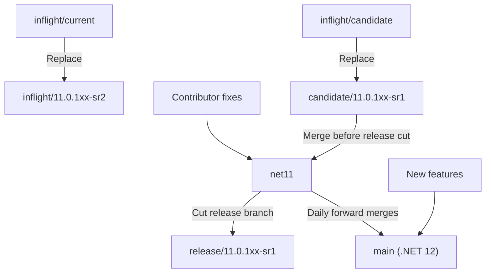
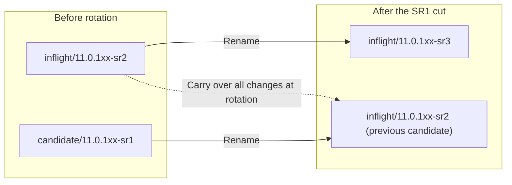
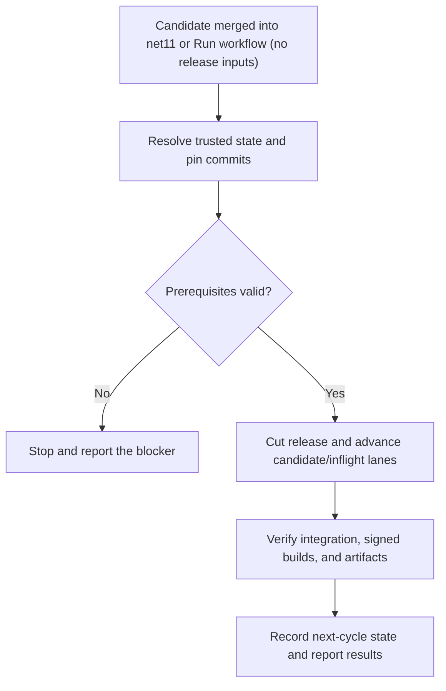
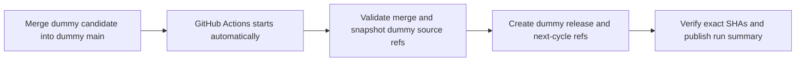

# Proposed versioned release branch workflow

This proposal separates .NET 11 fixes from .NET 12 feature development and replaces
the moving `inflight/current` and `inflight/candidate` names with release-specific
branches. It describes branch integration and release cuts; package building,
signing, and publishing remain covered by the [release process](ReleaseProcess.md).

> [!IMPORTANT]
> These are proposed branch names and responsibilities, not a statement that the
> migration has happened. The next-candidate naming decision below must be resolved
> before adopting the recurring rotation. This change does not rename production
> branches or enable production release automation.

## Branch responsibilities

| Branch | Responsibility |
|---|---|
| `net11` | Contributor target for .NET 11 fixes. Receives the current candidate before a release is cut. |
| `main` | .NET 12 development, including new features and daily forward merges from `net11`. It remains named `main`. |
| `candidate/11.0.1xx-sr1` | Changes staged for the current servicing release, SR1, to be merged into `net11`. |
| `inflight/11.0.1xx-sr2` | Changes staged for the following servicing release, SR2, while SR1 is prepared. |
| `release/11.0.1xx-sr1` | Release branch cut from `net11` after the SR1 candidate is merged. This branch is not renamed as part of the next cycle. |

`net11` is the proposed branch name used throughout this workflow. Daily merges
flow from `net11` to `main`; the proposal does not call for merging .NET 12 feature
development back into `net11`.

The public `net11` branch preserves all `main` history through
`f3b45e183ce6d9bdb28b3e090d849ddfdbc37eb0`, before the .NET 12 transition.
The branch name remains literal `net11`, distinct from historical `net11.0`.
The primary build, device-test and UI-test YAML include `net11` and
`candidate/*` in push/PR filters. The official build includes `net11` for its
schedule, signing, localization and API scanning. Deploy these definitions and
review server-side protections before relying on the new branch's CI.
The reviewer/gate and immutable snapshot validation recognize these names too,
but provisioning with credentials requires the new servicing/staging targets to
be protected. Until protection is configured, review setup fails explicitly
instead of switching a credential-bearing worktree to an unprotected branch.

## Initial migration and release cut

| Existing branch | Replacement |
|---|---|
| `inflight/current` | `inflight/11.0.1xx-sr2` |
| `inflight/candidate` | `candidate/11.0.1xx-sr1` |

Contributors target fixes at `net11`. Merge `candidate/11.0.1xx-sr1` into `net11`,
then cut `release/11.0.1xx-sr1` from the selected `net11` commit. The release is cut
from `net11`, not directly from the candidate or inflight branch. In parallel,
merge `net11` into `main` daily so .NET 12 development receives the fixes.



## Requested rotation after the SR1 cut

The requested branch moves are:

1. Rename the old `inflight/11.0.1xx-sr2` branch to `inflight/11.0.1xx-sr3`.
2. Rename the old `candidate/11.0.1xx-sr1` branch to `inflight/11.0.1xx-sr2`.
3. Bring all changes from the old SR2 inflight branch into the branch that was
   previously the SR1 candidate.

The source of the third step is the old SR2 inflight branch's contents at the
rotation, not the branch now reusing its name. Preserve that source commit when
planning the moves so the name reuse cannot select the wrong source.



### Next-candidate naming decision

The requested rotation above leaves two `inflight/...` branches and no
`candidate/11.0.1xx-sr2`. A candidate must be identified before the same
candidate-to-`net11` release flow can repeat.

The proposed clarification is to name the previous candidate branch
`candidate/11.0.1xx-sr2`, rather than `inflight/11.0.1xx-sr2`, after bringing over
the old SR2 inflight changes. The old SR2 inflight branch still advances to
`inflight/11.0.1xx-sr3`. This is a naming decision for the proposal, not an
approved change to the requested rotation.

With that clarification, the repeating cycle is:

| Release cut from `net11` | Next candidate | Next inflight |
|---|---|---|
| `release/11.0.1xx-sr1` | `candidate/11.0.1xx-sr2` | `inflight/11.0.1xx-sr3` |
| `release/11.0.1xx-sr2` | `candidate/11.0.1xx-sr3` | `inflight/11.0.1xx-sr4` |
| `release/11.0.1xx-sr3` | `candidate/11.0.1xx-sr4` | `inflight/11.0.1xx-sr5` |

For each SR number `N`, merge its candidate into `net11` and cut
`release/11.0.1xx-srN`. At rotation, the previous candidate receives all changes
from the old SR `N+1` inflight and becomes the SR `N+1` candidate, while the old
inflight advances to SR `N+2`. Keep the release branch separate from these moves,
and continue the daily `net11`-to-`main` merges.

## Rolling integration PRs

Maintain these two draft PRs against the fixes branch, `net11`:

| Title | Head | Purpose |
|---|---|---|
| `[Release candidate] 11.0.1xx SR1` | `candidate/11.0.1xx-sr1` | The current release's reviewed integration into `net11`. |
| `[Next release preview] 11.0.1xx SR2` | `inflight/11.0.1xx-sr2` | Visibility into the following release, like the historical `inflight/current` tracking PR. Do not merge this ahead of the current candidate. |

`Release tracking PRs` reconciles these routes from the canonical release-state
record every six hours, when that record changes on `main`, after a same-repo
candidate or inflight PR merges into `net11`, on pushes to the development and
lane branches, or on zero-input manual activation. It checks out trusted `main`,
not the merged PR's head. Its user credential needs PR write access and branch
creation access for recovery; repository protections still apply.

GitHub-hosted reconciliation uses its repository-scoped `GITHUB_TOKEN`:
new automated PRs are authored by `github-actions[bot]`. No personal token,
repository secret, or user impersonation is needed. Each description has a short
role explanation and a Mermaid graph highlighting its lane. Existing managed
PRs can retain their original human author while the bot updates them; their
authors cannot be changed in place. Newly recreated PRs use the bot.
Sandbox titles explicitly identify the trial so they cannot be confused with
real release trackers. Manual CLI reconciliation uses the caller's existing
authenticated identity.

The reconciler creates missing PRs as drafts, refreshes managed titles and
descriptions, and never approves or merges them. A head-branch change requires a
new PR: GitHub cannot retarget an existing PR's head. After both new-cycle PRs
exist, it closes obsolete PRs bearing its own scope marker. It does not adopt or
close unrelated human-created PRs, including the legacy tracking PR, automatically.
If an exact route already has an unmanaged PR or multiple open PRs, reconciliation
stops for inspection rather than creating a duplicate.

GitHub will not create a PR whose head has no commits ahead of its base. In that
case the reconciler explicitly reports `waiting-for-changes` and creates the PR
when real changes arrive; it does not add fake commits to satisfy a literal
"always two" count. Initially, the SR1 candidate was seeded at the same commit as
`net11`, so that route must wait for changes. Existing PRs can remain open while
their diff becomes empty.

Merge handling is automatic as well. If a tracking PR merges but the same lane
is still current, its replacement waits until that head has new commits ahead of
`net11`; the next lane push triggers reconciliation. Once the trusted release
state advances, reconciliation creates the next candidate and preview PRs with
updated SR numbers, branches, descriptions, and highlighted graphs, then retires
obsolete managed previews. It does not increment the release state just because
someone merged a preview PR.

GitHub can automatically delete a head branch after merge. If a current lane ref
is missing, the reconciler restores it only from a live, verified, same-repo
merged managed PR's exact head SHA. It never resets an existing branch, invents
the development target, restores an obsolete role from an older release state,
or recreates a branch from an unrelated/unmerged PR.

The release rollover must advance `currentSr` in the protected state record and
invoke reconciliation after the new lane refs are ready. Updating the record also
advances the titles and routes to candidate SR2 and inflight SR3. Branch pushes
then update each PR's diff naturally.
The rollover must call the reconciler directly rather than rely only on push
events: writes using `GITHUB_TOKEN` may not emit another workflow activation.
The scheduled reconciliation is a recovery path, not the primary merge trigger.

For read-only inspection before deployment:

```powershell
pwsh -NoProfile -File eng/scripts/Sync-ReleaseTrackingPullRequests.ps1 -PlanOnly
```

## Automatic servicing configuration and phase separation

`eng/scripts/MauiReleaseConfiguration.psm1` implements deterministic version/content
commits without changing a checkout, its index, or global Git configuration.
It validates literal XML metadata against the trusted release band and SR before
editing the specific properties. Unknown conditions, wrong majors/bands, duplicate
properties, or a patch from another cycle stop preparation. Branch names never
substitute for package-version evidence.

| Phase | Actual configuration change |
|---|---|
| Create candidate SR N | Preserve its verified `PatchVersion` (including a hotfix within the cycle), set `PreReleaseVersionLabel=servicing`, remove the CI-label override, and set `StabilizePackageVersion=true`. |
| Integrate approved candidate | Cut release SR N at the exact approved merge commit. No release version is added to the bug template. |
| After the cut | Add a fixes-lane housekeeping child restoring `ci.main`, the standard inflight-label condition, and `StabilizePackageVersion=false`; advance `PatchVersion` to `(N+1)*10`. Forward this normalized fixes tip, not the intermediate servicing tip, into feature `main`. |
| Create next lanes | Cleanly Git-merge normalized fixes with the pinned old inflight; configure candidate SR N+1 for servicing, then create inflight SR N+2 with CI branding and patch `(N+2)*10`. |
| Verified stable publication | Prepare a separate metadata commit adding the published version once to **both** bug-report version dropdowns on the configured feature/default branch. |

These are the focused servicing transitions used by
[#35520](https://github.com/dotnet/maui/pull/35520) and
[#39774](https://github.com/dotnet/maui/pull/39774), the separate next-cycle patch
bump used by [#35879](https://github.com/dotnet/maui/pull/35879), and the two-dropdown
housekeeping used by [#37685](https://github.com/dotnet/maui/pull/37685).
SDK/dependency pins, assembly versions, and unrelated release toggles are retained.

The next candidate includes the normalized fixes commit in its ancestry. Merely
copying the old inflight tree would let a later ordinary Git merge silently retain
the fixes branch's CI defaults, because servicing was unchanged relative to the
older common ancestor. A real three-way merge preserves both approved fixes and
future inflight content. Conflicts stop the operation; no file is blindly replaced.
Future inflight content is never included in the release already cut.

The current production SR2 ref was originally seeded with SR1 `PatchVersion=10`.
This is **not** verified SR2 package metadata. The sandbox initializes new lanes
with explicit, trusted one-cycle version transitions; it never rewrites an existing
mismatched production lane. The real migration needs a separately reviewed metadata
and baseline reconciliation before these helpers can be used there. This logic does
not invent a .NET 11 GA/SR0 baseline or certify candidate inventory.

### Published-version housekeeping

`Prepare published release versions` runs on a GitHub Release `published` event
(or a zero-input manual retry), using scripts from the trusted default branch.
`Sync-ReleasePublishedVersions.ps1` selects stable published servicing Releases
within the configured train, resolves each immutable tag, checks the exact
`eng/Versions.props` version/stabilization and servicing-branch ancestry, and
prepares a metadata commit against the pinned feature branch. A tag alone, draft
Release, prerelease, CI build, or candidate merge is insufficient.

This workflow has **contents-read permission only**. It uploads the pending commit
as a Git bundle plus its verified evidence; it does not push or merge a production
metadata change. This prepares the correct post-ship work automatically while the
production mutation policy is unresolved. Human integration remains a production
gate, not a claim that housekeeping was applied. If both dropdowns already contain
the published version (including an existing `SR`-labeled entry), no empty commit is
created. Repeated preparation at the same inputs yields the same commit.

For local read-only preparation:

```powershell
pwsh -NoProfile -File eng/scripts/Sync-ReleasePublishedVersions.ps1 -OutputDirectory <artifact-directory>
```

## Nightly builds and dogfood feeds

Versioned inflight branches must keep the same nightly contract as
`inflight/current`: the internal `dotnet-maui` pipeline, daily 05:00 UTC signed
builds, `ci.inflight` package branding, workload artifacts, BAR registration, and
the configured dogfood feed. Renaming or creating a public branch alone does not
provide any of those external integrations.

The official schedule recognizes versioned `inflight/*xx-sr*` refs. A selection
stage runs before packing on scheduled inflight builds and reads the release
state from a pinned commit on public `main`. It selects only one publishing lane:

| `nightlyMode` | Eligible nightly source |
|---|---|
| `legacy` | `inflight/current` |
| `versioned` | `inflight/<releaseBand>-sr<currentSr+1>` |

The checked-in mode remains **`legacy` during migration**. In versioned mode,
SR1's inflight source is SR2; after the trusted release state advances to SR2,
the source becomes SR3 automatically. Retained older inflight branches and the
legacy branch skip packing when not selected, so they cannot make a retired
stream appear fresh. Missing or invalid canonical state fails selection instead
of falling back to another branch.

Versioned inflight refs keep `PreReleaseVersionLabel=ci.inflight` and the existing
signing path. `main`, candidate branches, tags, and other inflight experiments
retain their existing branding. No feed or channel is invented from the SR name;
the existing publishing and Maestro configuration must be preserved and verified.
The readiness feed check continues measuring `ci.inflight`, not a fresh
`ci.main` build.

Before switching `nightlyMode` to `versioned`, deploy the schedule/selection,
signing, and branding changes to the mirrored legacy and active versioned
branches. Verify that the internal mirror has the exact selected public commit,
that its default-channel/feed wiring matches the existing nightly contract, and
that a signed internal build publishes the expected artifacts. Do not rewrite
mirror history or promote workload-release packages as part of this migration.
The same deployment prerequisite applies when each new lane is created.

The public PR and sandbox do not deploy internal mirrors, change Maestro
subscriptions, or certify an actual signed nightly. They must not be reported as
an operational nightly cutover until that internal evidence exists.

The internal YAML preview accepted both the ordinary path and the
scheduled-inflight template path, including the selection-stage dependency on
`Pack`. The latter preview supplied explicit scheduled branch context through a
root YAML override because preview requests do not adopt the queued system
variables. It did not queue a build or execute signing or publishing.

## One-click release automation

The proposed activation point is a GitHub Action after a reviewed candidate
merge into `net11`, with a zero-input **Run workflow** option for manual
activation. Internal signed-build work would remain in Azure DevOps. Production
orchestration is not implemented or enabled by this change. A separate GitHub
Actions sandbox below exercises automatic activation after a dummy candidate
merge without enabling production release operations.

### Operator experience

Merging the reviewed candidate into `net11` would start the release preparation
automatically, without an additional button. For manual activation, the release
owner would open GitHub Actions and select **Run workflow**. Neither path has
release fields to fill in: the owner does not select or type the release band, SR
number, branch names, commit SHAs, build IDs, or channel names. Activation is the
authorization to perform the configured routine branch rollover; there is no
second routine approval prompt for those operations.

The pipeline generates and records its resolved plan, checks prerequisites, runs
the rollover, and reports the resulting refs and validation links. If a
prerequisite is missing or the release state is ambiguous, it stops with an
actionable explanation rather than guessing values or asking the operator to
complete a release form.

Normal candidate-PR reviews and any required external configuration or
package-publication approvals remain separate. Activation must not bypass branch
protections or existing service approval checks.

### Automatic input resolution

Each activation target is bound to one release train through a trusted,
version-controlled release-state record. Initial setup defines the train and
branch roles once, including the resolved candidate-naming policy. Multiple
active trains must not be resolved by guessing from the highest branch number or
from `main`, which represents a different .NET version in this proposal.

| Input | Resolved automatically from |
|---|---|
| Release band and development branches | The configured release train and its `net11` / `main` branch roles. |
| Current SR and candidate/inflight refs | The active lane state, validated against actual refs and the configured naming policy. |
| Release source commit | The eligible, approved candidate merge into `net11`, with required validation at the exact selected commit. |
| Next candidate and inflight names | The current SR number and the agreed SR `N+1` / SR `N+2` rotation rules. |
| Build and BAR identities | Eligible signed-build evidence for the pinned release commit and configured official pipeline; never an unrelated latest build. |
| Channel mappings, subscriptions, and mirror refs | Their trusted configuration, checked against the selected release train; never invented from branch-name similarity. |

Candidate integration and its normal reviews must be complete before a release
cut can proceed. The pipeline detects that state itself; the operator does not
enter a merge SHA. When a signed build is needed, it queues or locates the build
for the pinned commit and waits for eligible results instead of requesting a
build ID from the operator.



### Execution safeguards

Serialize runs per release train and persist a checkpoint for each completed
operation. Recheck expected source SHAs before mutations, and resume the same
recorded cycle after an interruption rather than starting a different plan.
Advancing lane names alone must not make another release eligible: a new cycle
requires a distinct approved candidate merge that has not already been released.
Repeated activation without one reports the existing cycle or the missing
prerequisite, rather than cutting the next SR accidentally.

Only report success when the required integrations and validation have completed.
Configuration PRs that still need owner approval are pending work, not successful
handoffs. The routine rollover must not force-push history, delete historical
release refs, or publish packages. Package publishing retains the separate gates
in the [release process](ReleaseProcess.md).

Daily `net11`-to-`main` forward PRs require a separate trusted scheduled workflow,
stopping for conflicts or failed validation instead of guessing fixes. Forward
only a CI-normalized fixes tip, never the intermediate servicing integration tip.
The candidate runner does not perform daily forwarding.

### Read-only planning trial

A branch-planning prototype is available without release inputs:

```powershell
pwsh -NoProfile -File eng/scripts/Get-ReleaseRolloverPlan.ps1
```

It reads the proposed state in `eng/release-rollover.json`, queries branch refs
without changing them, and emits a JSON snapshot with the derived release, next
candidate, and next inflight names. The checked-in candidate-naming policy is
deliberately `unresolved`; the trial must report that decision and any missing
branches rather than silently choose a different workflow.

Exit code `0` means only that branch planning completed. Exit code `2` means
the plan is blocked by missing source refs, occupied destination names, or the
unresolved naming policy; malformed state or Git failures also fail explicitly.
Every result has `canExecute: false` and lists the release requirements that this
prototype does not verify. A complete branch plan is not release readiness.

For isolated development trials, `-StatePath` can point at a separate state file
whose repository is a disposable local Git repository. This is not a release form
or an activation input for the proposed pipeline. The Azure pipeline, branch
mutations, external integrations, and publishing are not implemented by this
prototype.

### GitHub Actions merge-triggered sandbox

The **Release rollover sandbox** workflow runs automatically when a merge is
pushed to `release-rollover-trial/<trial>/main`. That branch is an isolated dummy
integration target, not the real `main` branch. In the proposed production
workflow, the candidate still merges into `net11`, while real `main` receives
daily fixes for .NET 12.

For a clean start, create only the dummy integration branch at a verified source
commit whose package metadata agrees with the trusted current SR. Its creation
event creates a genuinely servicing-configured candidate and correctly versioned
CI inflight lane, then initializes the first two tracking PRs without cutting a release.
Initialization refuses a namespace that already contains release refs.
Existing lane destinations must match the deterministic prepared commits exactly;
an older manually seeded lane is not silently updated.

The workflow derives the release band and SR number from the candidate ref
matching the merge commit's second parent. Release cuts require a two-parent merge, an
unchanged integration HEAD (or its exact deterministic housekeeping child on
retry), and an inflight branch containing that candidate with verified next-cycle
package metadata. The approved merge must retain the candidate's version configuration.
An ordinary commit, ambiguous candidate, missing source, divergent history, or
destination at a different SHA stops the run instead of guessing. A shallow fetch
that cannot prove ancestry also stops the run.

For a dummy SR1 candidate merge, it creates only these sandbox refs:

| Dummy output under `release-rollover-trial/<trial>/` | Source commit |
|---|---|
| `release/11.0.1xx-sr1` | The exact candidate merge commit on dummy `main`. |
| dummy `main` | A housekeeping child of that exact merge: next-cycle patch, `ci.main`, non-stable packages. |
| `candidate/11.0.1xx-sr2` | Servicing-configured child of a clean merge of normalized fixes and pinned old SR2 inflight. |
| `inflight/11.0.1xx-sr3` | CI-configured child of the next candidate, with SR3 patch metadata. |

This trial uses the proposed `candidate/...` naming clarification only inside
the sandbox. It creates new refs and preserves historical source branches; it
does not test renaming or deletion. The real naming policy remains unresolved.



Each sandbox has a serialized workflow concurrency group. Fixed commit identity,
parent-derived commit time, and actual content changes make preparation deterministic.
Existing outputs at the exact expected SHAs are left unchanged. Ref creation and
the fixes housekeeping fast-forward are published with a single atomic Git push,
without persisted credentials or force-pushing. No other existing target is updated.
Retrying the original merge activation, or its verified housekeeping child, does
not cut the next release, create more commits, or duplicate metadata. Moved sources
or destinations require inspection.

After creating its next-cycle refs, the sandbox invokes the same tracking-PR
reconciler with a sandbox-scoped state file. Both dummy PRs target dummy `main`,
never a real development branch. This exercises PR creation and repeated
reconciliation without enabling the production release workflow.

For an actual merged managed PR, the sandbox uses verified merge metadata rather
than guessing its role from commit equality. It can restore a candidate head
deleted after merge, using exactly that merged PR's source SHA. A merged preview
activates tracking-only reconciliation: it does not cut another release or
advance the servicing cycle.

The workflow uses its repository-scoped `GITHUB_TOKEN` with contents/PR write
permissions only in the mutation job; checkout does not persist credentials.
It does not use `pull_request_target`, check out fork code,
or run an AI agent. There is no trigger on real `main`, `net11`, `candidate/...`, or
`inflight/...`. Normal merge commits are required for this trial; squash and
rebase merges are not supported. The workflow can also be activated manually on
a sandbox integration ref after it is available for dispatch in GitHub.

This exercises branch operations only. It does not validate production
permissions, candidate approvals, signed builds, packages, dependency
subscriptions, channel mappings, the internal mirror, or production rollback.

The business-logic/isolated Git harness runs two real local candidate merges and
evaluates package/workload properties with MSBuild, including the second-cycle
ancestry requirement, wrong-cycle refusal, preserved content, immutable release
cut, CI restoration, publication gating, and duplicate-free retries:

```powershell
pwsh -NoProfile -File eng/scripts/MauiReleaseConfiguration.Tests.ps1
```

The following live records predate servicing-preconfiguration changes and remain
evidence for the earlier branch/PR prototype, not certification of the new content
transitions or a production shipment.

### Live sandbox evidence

The GitHub-hosted trial used `release-rollover-trial/sr1-2ad2e0af/` on
2026-11-05. Both cycles were activated by actual candidate merges pushed to the
dummy integration branch, not by a fabricated event payload or a local script.

| Scenario | Observed result |
|---|---|
| [SR1 candidate merge](https://github.com/dotnet/maui/actions/runs/42035924272) | Created dummy release SR1 at the merge SHA, candidate SR2, and inflight SR3 automatically. |
| Same activation rerun, attempt 2 | Reported `unchanged`, created no refs, and left every dummy ref at the same SHA. |
| [SR2 candidate merge](https://github.com/dotnet/maui/actions/runs/42036225919) | Detected SR2 without version inputs and created dummy release SR2, candidate SR3, and inflight SR4. |
| [Ordinary non-merge push](https://github.com/dotnet/maui/actions/runs/42036351766) | Failed as intended with the two-parent-merge diagnostic and created no release or next-cycle refs. |

Distinct marker files confirmed that release SR1 contained the SR1 candidate
change but not the future SR2 change; candidate SR2 contained both, and release
SR2 subsequently included the future change. Run artifacts recorded exact source
and output SHAs. The real development and release-lane refs were unchanged by
the trial.

The subsequent [managed candidate PR merge trial](https://github.com/dotnet/maui/actions/runs/42042956214)
merged a real dummy candidate PR, recovered its deleted head at the exact merged
source SHA, created the next candidate/preview pair with updated graphs, and
closed the obsolete preview. A repeated run after deliberate deletion of that
merged dummy head restored it without creating duplicate PRs.

The [managed preview PR merge trial](https://github.com/dotnet/maui/actions/runs/42043918558)
performed tracking-only reconciliation, recovered current lane heads deleted
after merge, and did not cut another release. Empty routes waited for real
changes; after follow-up work arrived, reconciliation recreated the pair.

Historical closed/merged trial records retain their original authors. The active
workflow policy uses the Actions bot for new automated PRs, without replacing
existing open PRs solely to change their author.

The [final bot-backed merge trial](https://github.com/dotnet/maui/actions/runs/42046166565)
merged a human-authored dummy candidate and automatically created candidate SR4
and preview SR5 as `github-actions[bot]`, with refreshed titles and Mermaid graphs.
The obsolete human-authored preview was closed only after the replacement pair
existed. The sandbox workflow was re-enabled with its scoped Actions token; no
personal token, additional secret, or user-impersonation configuration was used.
A rerun left the same two PRs and all output refs unchanged.

The [clean-start visual replay](https://github.com/dotnet/maui/pull/39913#issuecomment-6661729586)
documents the later full sandbox sequence with real GitHub screenshots:
initial tracking PRs before any cut, two candidate merges, exact release refs,
content isolation, preview retirement, and a duplicate-free rerun. The replay
removed its dummy refs afterward and distinguishes manual/configuration checks
from production automation.

### Servicing configuration evidence (2026-11-06)

The later `release-rollover-trial/config2-15d039f6/` trial exercised real content
commits and actual managed candidate PR merges with the new helpers:

| Scenario | Observed result |
|---|---|
| [Initialization](https://github.com/dotnet/maui/actions/runs/42187385854) | Created servicing/stable candidate SR1 at patch 10 and CI inflight SR2 at patch 20; no release cut. |
| [SR1 merge and rollover](https://github.com/dotnet/maui/actions/runs/42187695506) | Release SR1 remained at approved merge `21277c05c32874316543b64ee4f4732e4cf77739`; fixes moved to a CI housekeeping child at patch 20, next candidate used servicing patch 20, and inflight SR3 used CI patch 30. |
| [Housekeeping-tip retry](https://github.com/dotnet/maui/actions/runs/42187880344) | Reported `unchanged`, with no ref creations/updates and the same two tracking PRs. |
| Original SR1 event rerun, attempt 2 | Reported `unchanged`; full ref snapshots and PR identities matched the completed cycle. |
| [Second candidate merge](https://github.com/dotnet/maui/actions/runs/42188092513) | Release SR2 retained servicing patch 20 at approved merge `912ff52a20309843a2f718d592eddcfce6030b47`; normalized fixes and candidate SR3 used patch 30, while future inflight SR4 used patch 40. |

MSBuild evaluated the actual hosted XML: releases/candidates enabled
`IsServicingBuild=true`, stable package versions, and no workload suffix; the
fixes tip used `-ci.main`, and the future sandbox inflight used `-ci.inflight`.
The candidate runner changed no bug-template released-version entries. A live
public-data preparation run found no verified .NET 11 servicing publication and
created no metadata commit.

An earlier housekeeping-tip trial failed because a depth-one checkout left its
activation commit marked as a shallow root. The corrected fetch includes that
activation tip. An isolated shallow-clone case reproduces the old failure and
proves the corrected fetch reconstructs the identical next-lane integration.
Local preparation uses full-history fetches; bounded fetches are confined to
GitHub Actions checkouts and disposable test clones, not app-managed worktrees.

The isolated business harness also verifies a published-release fixture produces
one metadata commit, adds the version once to each dropdown, can be exported and
applied as a Git bundle, and is unchanged on retry. That fixture is **not**
production shipment evidence.
Both owned dummy namespaces were removed and their remaining draft PRs closed
after evidence capture. Public `main`, `net11`, candidate, and inflight ref
snapshots remained identical. No production release, tag, package, channel, or
mirror operation was performed.

## Adoption scope

Merging this PR is not a complete production release transition. The clean-start
sandbox proves the branch/PR lifecycle, not the following remaining work:

| Surface | Remaining production requirement |
|---|---|
| Release cuts and rotation | Implement the protected production orchestrator, including persistent state advancement and recovery. The current mutation runner is sandbox-only. |
| Servicing and post-ship metadata | Reconcile real lane baselines/package metadata, wire these validated helpers into the protected production orchestrator, and integrate the prepared post-publication metadata commit. |
| Daily forward merges | Deploy and validate the separate trusted fix-forward PR workflow, including the CI-normalized source gate. A manual merge does not validate unattended scheduling. |
| New branch names | Deploy the explicit `net11` / `candidate/*` CI YAML coverage in this PR and review protections and readiness discovery. Server-side/manual runs are not proof that the deployed branch triggers are wired. |
| Signed nightly builds | Deploy the internal mirrored source changes and validate signed artifacts and feed/channel handoff before changing `nightlyMode` from `legacy`. |
| .NET 12 development | Update `main` and its dependency flow separately; creating `net11` does not change `main`'s SDK. |
| Candidate naming | Resolve the production rotation policy before enabling release mutations. |

Adopting this proposal requires coordinating the branch changes with their
protections, pipeline branch filters, scheduled merges, dependency-update
configuration, and internal release mirror. Those operational changes are outside
the scope of this documentation proposal. Existing contribution and release
instructions remain in effect until the migration is adopted.
