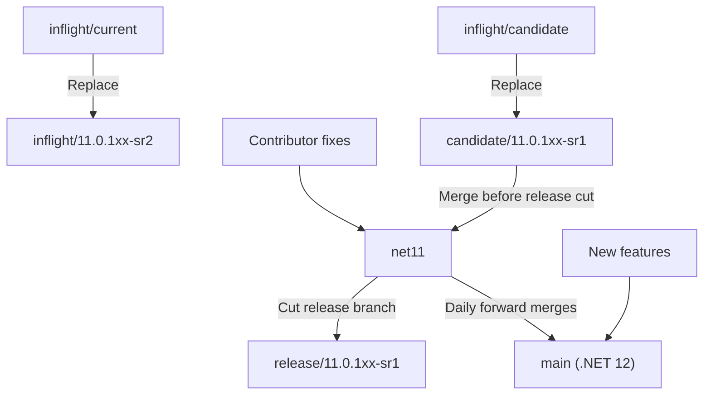
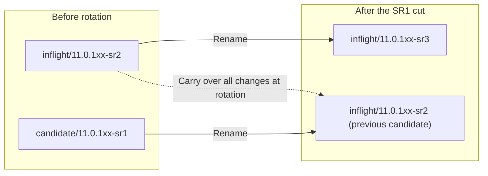
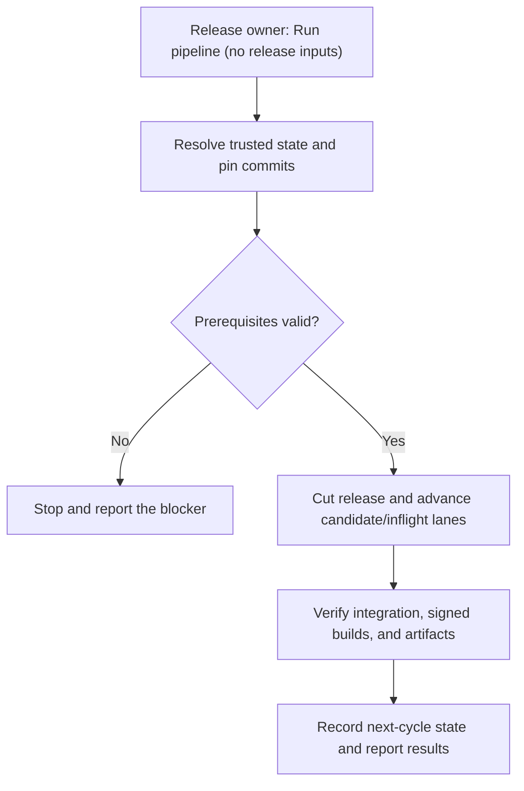

# Proposed versioned release branch workflow

This proposal separates .NET 11 fixes from .NET 12 feature development and replaces
the moving `inflight/current` and `inflight/candidate` names with release-specific
branches. It describes branch integration and release cuts; package building,
signing, and publishing remain covered by the [release process](ReleaseProcess.md).

> [!IMPORTANT]
> These are proposed branch names and responsibilities, not a statement that the
> migration has happened. The next-candidate naming decision below must be resolved
> before adopting the recurring rotation. This document does not rename branches
> or change release automation.

## Branch responsibilities

| Branch | Responsibility |
|---|---|
| `net11` | Contributor target for .NET 11 fixes. Receives the current candidate before a release is cut. |
| `main` | .NET 12 development, including new features and daily forward merges from `net11`. It remains named `main`. |
| `candidate/11.0.1xx-sr1` | Changes staged for the current servicing release, SR1, to be merged into `net11`. |
| `inflight/11.0.1xx-sr2` | Changes staged for the following servicing release, SR2, while SR1 is prepared. |
| `release/11.0.1xx-sr1` | Release branch cut from `net11` after the SR1 candidate is merged. This branch is not renamed as part of the next cycle. |

`net11` is the proposed branch name used throughout this workflow. Daily merges
flow from `net11` to `main`; the proposal does not call for merging .NET 12 feature
development back into `net11`.

## Initial migration and release cut

| Existing branch | Replacement |
|---|---|
| `inflight/current` | `inflight/11.0.1xx-sr2` |
| `inflight/candidate` | `candidate/11.0.1xx-sr1` |

Contributors target fixes at `net11`. Merge `candidate/11.0.1xx-sr1` into `net11`,
then cut `release/11.0.1xx-sr1` from the selected `net11` commit. The release is cut
from `net11`, not directly from the candidate or inflight branch. In parallel,
merge `net11` into `main` daily so .NET 12 development receives the fixes.



## Requested rotation after the SR1 cut

The requested branch moves are:

1. Rename the old `inflight/11.0.1xx-sr2` branch to `inflight/11.0.1xx-sr3`.
2. Rename the old `candidate/11.0.1xx-sr1` branch to `inflight/11.0.1xx-sr2`.
3. Bring all changes from the old SR2 inflight branch into the branch that was
   previously the SR1 candidate.

The source of the third step is the old SR2 inflight branch's contents at the
rotation, not the branch now reusing its name. Preserve that source commit when
planning the moves so the name reuse cannot select the wrong source.



### Next-candidate naming decision

The requested rotation above leaves two `inflight/...` branches and no
`candidate/11.0.1xx-sr2`. A candidate must be identified before the same
candidate-to-`net11` release flow can repeat.

The proposed clarification is to name the previous candidate branch
`candidate/11.0.1xx-sr2`, rather than `inflight/11.0.1xx-sr2`, after bringing over
the old SR2 inflight changes. The old SR2 inflight branch still advances to
`inflight/11.0.1xx-sr3`. This is a naming decision for the proposal, not an
approved change to the requested rotation.

With that clarification, the repeating cycle is:

| Release cut from `net11` | Next candidate | Next inflight |
|---|---|---|
| `release/11.0.1xx-sr1` | `candidate/11.0.1xx-sr2` | `inflight/11.0.1xx-sr3` |
| `release/11.0.1xx-sr2` | `candidate/11.0.1xx-sr3` | `inflight/11.0.1xx-sr4` |
| `release/11.0.1xx-sr3` | `candidate/11.0.1xx-sr4` | `inflight/11.0.1xx-sr5` |

For each SR number `N`, merge its candidate into `net11` and cut
`release/11.0.1xx-srN`. At rotation, the previous candidate receives all changes
from the old SR `N+1` inflight and becomes the SR `N+1` candidate, while the old
inflight advances to SR `N+2`. Keep the release branch separate from these moves,
and continue the daily `net11`-to-`main` merges.

## One-click release automation

The proposed implementation is an internal Azure DevOps pipeline named
`maui-release-rollover`, with its definition and scripts maintained in this
repository. It is not implemented or enabled by this documentation change.

### Operator experience

The release owner opens the pipeline and selects **Run pipeline**. There are no
release fields to fill in: the owner does not select or type the release band, SR
number, branch names, commit SHAs, build IDs, or channel names. Activation is the
authorization to perform the configured routine branch rollover; there is no
second routine approval prompt for those operations.

The pipeline generates and records its resolved plan, checks prerequisites, runs
the rollover, and reports the resulting refs and validation links. If a
prerequisite is missing or the release state is ambiguous, it stops with an
actionable explanation rather than guessing values or asking the operator to
complete a release form.

Normal candidate-PR reviews and any required external configuration or
package-publication approvals remain separate. Activation must not bypass branch
protections or existing service approval checks.

### Automatic input resolution

Each activation target is bound to one release train through a trusted,
version-controlled release-state record. Initial setup defines the train and
branch roles once, including the resolved candidate-naming policy. Multiple
active trains must not be resolved by guessing from the highest branch number or
from `main`, which represents a different .NET version in this proposal.

| Input | Resolved automatically from |
|---|---|
| Release band and development branches | The configured release train and its `net11` / `main` branch roles. |
| Current SR and candidate/inflight refs | The active lane state, validated against actual refs and the configured naming policy. |
| Release source commit | The eligible, approved candidate merge into `net11`, with required validation at the exact selected commit. |
| Next candidate and inflight names | The current SR number and the agreed SR `N+1` / SR `N+2` rotation rules. |
| Build and BAR identities | Eligible signed-build evidence for the pinned release commit and configured official pipeline; never an unrelated latest build. |
| Channel mappings, subscriptions, and mirror refs | Their trusted configuration, checked against the selected release train; never invented from branch-name similarity. |

Candidate integration and its normal reviews must be complete before a release
cut can proceed. The pipeline detects that state itself; the operator does not
enter a merge SHA. When a signed build is needed, it queues or locates the build
for the pinned commit and waits for eligible results instead of requesting a
build ID from the operator.



### Execution safeguards

Serialize runs per release train and persist a checkpoint for each completed
operation. Recheck expected source SHAs before mutations, and resume the same
recorded cycle after an interruption rather than starting a different plan.
Advancing lane names alone must not make another release eligible: a new cycle
requires a distinct approved candidate merge that has not already been released.
Repeated activation without one reports the existing cycle or the missing
prerequisite, rather than cutting the next SR accidentally.

Only report success when the required integrations and validation have completed.
Configuration PRs that still need owner approval are pending work, not successful
handoffs. The routine rollover must not force-push history, delete historical
release refs, or publish packages. Package publishing retains the separate gates
in the [release process](ReleaseProcess.md).

The daily `net11`-to-`main` merge PR runs on a schedule independently of release
activation, stopping for conflicts or failed validation instead of guessing fixes.

### Read-only planning trial

A branch-planning prototype is available without release inputs:

```powershell
pwsh -NoProfile -File eng/scripts/Get-ReleaseRolloverPlan.ps1
```

It reads the proposed state in `eng/release-rollover.json`, queries branch refs
without changing them, and emits a JSON snapshot with the derived release, next
candidate, and next inflight names. The checked-in candidate-naming policy is
deliberately `unresolved`; the trial must report that decision and any missing
branches rather than silently choose a different workflow.

Exit code `0` means only that branch planning completed. Exit code `2` means
the plan is blocked by missing source refs, occupied destination names, or the
unresolved naming policy; malformed state or Git failures also fail explicitly.
Every result has `canExecute: false` and lists the release requirements that this
prototype does not verify. A complete branch plan is not release readiness.

For isolated development trials, `-StatePath` can point at a separate state file
whose repository is a disposable local Git repository. This is not a release form
or an activation input for the proposed pipeline. The Azure pipeline, branch
mutations, external integrations, and publishing are not implemented by this
prototype.

## Adoption scope

Adopting this proposal requires coordinating the branch changes with their
protections, pipeline branch filters, scheduled merges, dependency-update
configuration, and internal release mirror. Those operational changes are outside
the scope of this documentation proposal. Existing contribution and release
instructions remain in effect until the migration is adopted.
